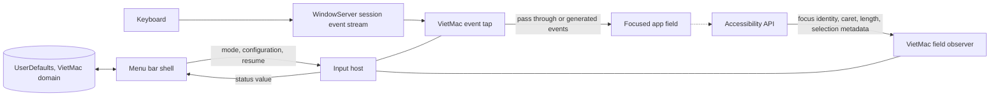
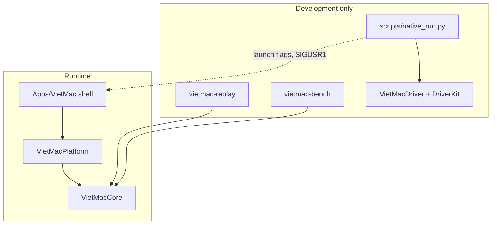
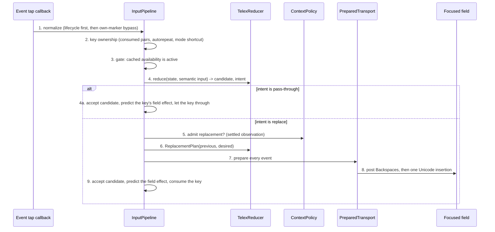
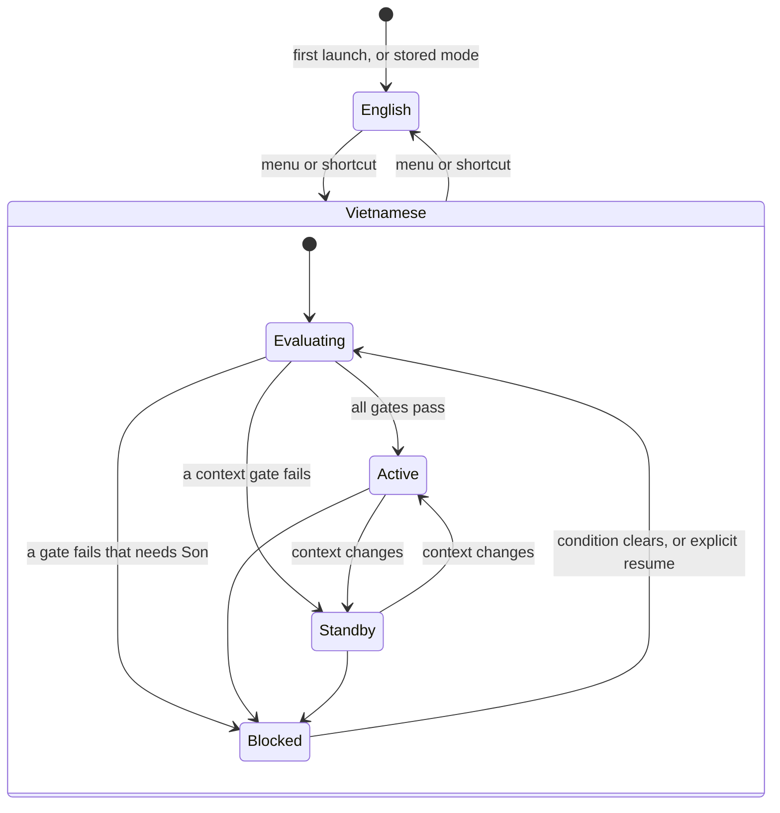
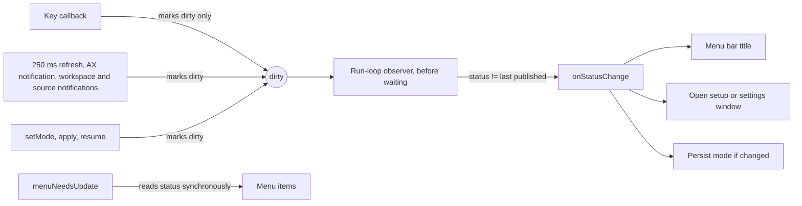

# VietMac architecture specification

Status: proposed target architecture. Written 2026-11-12 from repository state at commit `9458aa9`.
Reviewed the same day by the architect against `Sources/`, `Apps/`, the verification notes, the OpenKey comparison, and the three OpenSpec changes.
[architecture.md](architecture.md) remains the summary of delivered boundaries. This document specifies the complete personal app through MVP and the extension path after it.
Behavioral requirements stay in OpenSpec (`openspec/specs`, `openspec/changes`). This document owns structure, state ownership, and decisions.
The sequence of delivery is in [product-roadmap.md](product-roadmap.md). Screens, copy, and flows are in [ux-spec.md](ux-spec.md).

Claims that affect a decision carry a label: **verified** (evidence in the source, the ledger, or the verification notes), **inferred**, or **unknown**.
Sections marked *proposed* are new in this document. The architect has decided them unless section 12 lists them for Son's final gate.
Each **unknown** that blocks a decision has a test in section 14 (`U-n`).

## 1. Quality attributes, in priority order

| # | Attribute | Meaning | Mechanism |
| --- | --- | --- | --- |
| 1 | Text safety | Never delete or duplicate text VietMac does not own | Bounded owned word, observed field metadata, prepare-before-delete, pause instead of repair |
| 2 | Predictability | The same keys give the same word in every accepted field | One reducer, one NFC renderer, one tone convention, explicit English mode |
| 3 | Transparency | Son can always see why transformation is off, and what to do | One status value with a mode, an availability class, and one reason (section 7) |
| 4 | Ease of use | Setup and daily use need no documentation | Every user-visible state and action has one defined runtime source; few states need action |
| 5 | Latency | Typing never feels delayed | One run loop, no per-key I/O, AX, tasks, or allocation growth; bounded work beside the callback |
| 6 | Coverage | Works in the fields Son uses | Field profiles accepted only with native evidence |
| 7 | Extensibility | VNI, macros, new apps add without rewrites | Semantic input boundary and transport/profile boundary |

A lower attribute never buys a risk against a higher one. A field that cannot be made safe stays literal.
Ease of use ranks above latency and coverage because Son made it an explicit requirement on 2026-11-12. It never outranks text safety: no UI offers a way around a safety pause.

## 2. System context



- One process: `VietMac.app`, a menu bar agent (`LSUIElement`), bundle ID `local.sonquach.vietmac` (**verified**, `Apps/VietMac/Info.plist`).
- No helper process, XPC service, network client, database, or InputMethodKit component.
- The runtime reads three capabilities: Accessibility (`AXIsProcessTrusted`), event listening (`CGPreflightListenEventAccess`), and event posting (`CGPreflightPostEventAccess`) (**verified**, `RuntimeStatus.swift:17-23`).
  System Settings has two panes for them, Accessibility and Input Monitoring. Posting has no pane of its own; it is **inferred** to follow Accessibility. Section 7.6 has the full model.
- Grants follow the code-signing identity. The trusted local certificate `VietMac Local Signing` keeps grants across rebuilds (**verified**, sessions 3–5). Ad hoc signing ties a grant to one CDHash (**verified**, session 2). `scripts/build-app.sh` signs ad hoc unless `VIETMAC_SIGNING_IDENTITY` is set.
- The system input source stays ABC or U.S. VietMac never switches it and does not transform under any other source (**verified**, `InputHost.swift:117`).
- Deployment floor macOS 13 (`LSMinimumSystemVersion`). Tested only on macOS 27.0.1, arm64. Intel and macOS 13–26 are **unknown**.

## 3. Modules and dependency rules



| Module | Owns | Must not |
| --- | --- | --- |
| `VietMacCore` | Semantic input, Telex reducer, syllable and tone rules, NFC renderer, replacement planner | Import AppKit, Core Graphics, ApplicationServices; hold global state; know keycodes or apps |
| `VietMacPlatform` | Event tap, normalization, key ownership, live mode, field observation, field profiles, prepared transport, lifecycle, capability reads, the status value | Contain language rules; present UI; persist anything; write files in the callback |
| `Apps/VietMac` | Menu bar item, setup and settings windows, preference storage, login registration, instance lock, diagnostics export | Touch composition state, post events, or call the platform from anywhere but the main run loop |
| Development tools | Replay, benchmarks, native driver, runner, ledger, OpenSpec | Be linked into or required by the runtime |

Rules:

1. Dependencies point one way: App → Platform → Core. The driver depends on no VietMac module (**verified**, `Package.swift`).
2. One Swift package. A new target needs a responsibility and a dependency direction that an existing target cannot hold.
3. The M0 `PrototypePipeline` is replaced, not extended. After M2 there is one language implementation, in Core.

### Target components

| Component | Module | State | Replaces or extends |
| --- | --- | --- | --- |
| `TelexReducer` | Core | Instance-local `WordState` | New (M1) |
| `SyllableRules` | Core | Static pattern data | New (M1) |
| `Renderer` | Core | None | New (M1) |
| `ReplacementPlan` | Core | None | Delivered |
| `EventNormalizer` | Platform | None | Delivered, and already takes letter case from the event text (`EventNormalizer.swift:38-49`). M2: emits `CompositionInput` instead of `PrototypeInput`, and matches the mode shortcut before the generic chord rule |
| `InputPipeline` | Platform | Reducer instance, key ownership, live mode, pause state | Replaces `PrototypePipeline` (M2) |
| `FocusMonitor`, `FieldContextTracker` | Platform | Observed and predicted field metadata | Delivered |
| `ContextPolicy` | Platform | None | Delivered against `PrototypePipeline`; its signatures move to `InputPipeline` in M2 |
| `FieldProfile` table and resolver | Platform | Immutable table plus the current resolved profile | New (M2), section 6.4. Replaces `trialApps` |
| `PreparedTransport` | Platform | Event source and marker | Delivered; strategies added only with evidence |
| `InputHost` | Platform | Tap, timer, observers; owns all of the above; publishes `RuntimeStatus` | Delivered; gains the status interface of section 7.2 |
| `Configuration` | Platform | Immutable value: shortcut and exclusions | New (M2), section 6.6 |
| `StatusItemController`, `SetupWindow`, `SettingsWindow` | App | Presentation state only | New (M2); replace the M0 menu |
| `Preferences`, `LoginItem`, `InstanceLock` | App | Stored mode, shortcut, exclusions, startup request; registration state; the lock | New (M2) |

## 4. Per-key path

All mutable input state lives on the main run loop. The callback performs steps 1–9 synchronously.



### 4.1 What `InputHost.handle` does today (**verified**, `InputHost.swift:267-336`)

1. It normalizes: tap-disabled notifications first, then the marker bypass, then mouse, modifier, navigation, and chord events as `invalidate` (`EventNormalizer.swift:12-51`).
2. On key-down it consumes an autorepeat of a consumed key. A release of a consumed key is consumed in `PrototypePipeline.handle`, before the active gate, so pairing survives a pause.
3. The gate is `state == .active`, computed from an environment that is cached outside the callback.
4. A pass-through letter is appended to the tracked word inside `PrototypePipeline.handle`. A rule match returns `.replace` and changes nothing.
5. A replacement runs `admitsReplacement` → `ReplacementPlan.compute` → `prepare` → `send` → `accept` → `expectReplacement`. `send` checks `isCurrent` before each event.
6. Every failure before the first post invalidates the word, records the key as a pass-through, and returns the physical event.

The order matches the diagram for the replace branch. The diagram in the first version of this document omitted the pass-through branch, which is the path of most keys.

### 4.2 What must change for the full reducer (M2)

| # | Change | Reason |
| --- | --- | --- |
| C1 | The normalizer emits `CompositionInput` plus platform-only data (keycode, repeat flag) | Core must not see keycodes |
| C2 | The mode shortcut is matched in step 2, before the rule that turns every Command/Control/Option chord into `invalidate`, and it owns its key pair through the consumed-key table | One toggle per press in every state where the tap exists; exact ordering against the next key |
| C3 | Reduction is two-phase. Pass-through accepts the candidate at once (4a). Replace accepts only at step 9 | Today the prototype mutates on pass-through and defers on replace inside one function |
| C4 | Backspace can be a replace intent. `hoàn` plus Backspace must give `hòa` (telex-composition spec), which is delete 3, insert `òa`, with keycode 51 as the consumed trigger | AD-5 is proven only for a letter trigger. The insertion keycode for a Backspace trigger is **unknown** (U-5). Proposed rule: use the consumed trigger when it is a letter key; otherwise use a fixed letter keycode that a 128-bit key-down table shows as not held |
| C5 | The transport refuses an insertion longer than the natively tested length, before step 8 | Only one-character insertions have native evidence. Developer reports describe a 20-unit limit per event for `keyboardSetUnicodeString`; not confirmed in Apple documentation (**unknown**, U-4) |
| C6 | Step 3 reads the resolved profile and exclusions through the cached availability; step 5 uses the profile's assurance | Profiles replace `trialApps` |
| C7 | Prediction widths come from the rendered previous text of the intent | Today they come from `pipeline.word` |
| C8 | A state change inside the callback (timeout, tap disabled, uncertain send, shortcut toggle) only marks the status dirty | Section 7.4. The callback never calls the shell |

### 4.3 Invariants

- A failed step before 8 posts nothing, invalidates the word, and lets the physical key through.
- After step 8 starts there is no rollback. Uncertainty pauses with `transportUncertain` and consumes the trigger key.
- The candidate reducer state becomes the accepted state only at step 4a or step 9.
- The Unicode insertion uses a keycode the client does not see as held (**verified** for a letter trigger: fix for rollover data loss; see C4).
- Generated events carry no modifier flags, so a held Shift cannot change a generated Backspace (**verified**, `PreparedTransport.swift:43`).
- Not allowed in steps 1–9: AX calls, disk or network I/O, UI work, window enumeration, `Task`, actor hops, sleeps, unbounded allocation, capability or input-source lookups, calls into the shell.
- Outside the callback, on the same run loop: AX notifications, the 250 ms refresh, capability and source reads, profile resolution, status publication, preference writes, diagnostics export.
- Work beside the callback delays the callback, because both use the main run loop. One refresh makes up to five AX reads, each with a 50 ms timeout (`FocusMonitor.swift:58-120`), so an unresponsive target app can hold keystrokes for about 250 ms per refresh (**inferred**; U-10). Rule: an inspection stops at the first AX timeout, and no single work item on the run loop may exceed 50 ms.

## 5. Core design

The delivered contracts are `CompositionInput`, `ContextToken`, `CompositionIntent`, and `ReplacementPlan`.
The reducer design is specified in [telex-input-mvp/design.md](../openspec/changes/telex-input-mvp/design.md) decisions 2 and 3. This section fixes its shape.

```swift
struct Letter { var base: UInt8; var upper: Bool; var shape: Shape }   // a ă â e ê o ô ơ u ư d đ ...
struct WordState {
    var letters: BoundedArray<Letter>     // at most 64
    var tone: Tone?                       // one per word
    var escape: EscapeMarker?             // last shape operation, for repeated-key restore
    var status: Status                    // tracking | literalUntilBoundary
    var context: ContextToken
}
func reduce(_ state: WordState, _ input: CompositionInput) -> (next: WordState, intent: CompositionIntent)
```

- The state is the visible word, typed as letters. It is not a raw key history.
- `Renderer` is the only producer of output text: `WordState` → NFC `String`, tone target chosen by `SyllableRules` on normalized base letters.
- A replace intent carries complete previous and desired text. A pass-through intent carries none; the platform predicts one inserted unit. The platform never appends an implicit key.
- Backspace removes one visible letter and recomputes the tone target. When the recomputed text differs from the old text minus its last letter, the intent is a replacement (C4).
- Overflow, leading `w`, an ineligible modifier, or an escape sets `literalUntilBoundary`.
- Reducers are values. Two instances share nothing, so tests, replay, and a future per-field instance need no locking.

Extension boundary: an input method is a mapping from keys to semantic operations (`shape`, `tone`, `removeTone`, `letter`).
Telex is the first mapping. VNI adds a second mapping over the same `WordState`, `SyllableRules`, and `Renderer`.

## 6. Platform design

### 6.1 Runtime state



- Mode (English or Vietnamese) is Son's choice. The platform owns the live value, because the shortcut changes it inside the callback. The shell persists it (section 6.6).
- Availability is computed and never persisted. It has three classes (*proposed*; M0 has one `paused` class with twelve reasons):
  - **Active**: transformation can happen in the focused field.
  - **Standby**: nothing to do here. It clears by itself when the context changes. It is not a fault.
  - **Blocked**: Son must act. Some blocked reasons are sticky and clear only on explicit resume.
- Every transition into or out of Active clears the tracked word. Nothing restores an old word (**verified** for M0: `updateEnvironment`, `pauseFor`, `setEnabled`).
- Tap timeout recovery is bounded: three automatic recoveries per 60 seconds, then `recoveryLimit` until explicit resume (**verified**, `PrototypePipeline.swift:84-94`).
- English mode installs no event tap unless a shortcut is configured, and performs no AX observation. M0 differs: it inspects the focused element of a trial app every 250 ms even when disabled (`InputHost.swift:138`); M2 corrects this.
- A capability loss removes the tap at once. M0 keeps the tap installed while paused (`InputHost.swift:120-123`). An active tap whose Accessibility grant is revoked is reported to stall input (Apple developer forum reports; **unknown** on macOS 27, U-3).
  The refresh alone is not a sufficient defense: it acts only if the capability read reflects the revoke, and only after up to 250 ms. Three further measures apply (*proposed*):
  1. On the distributed notification `com.apple.accessibility.api` (undocumented, **inferred**), the host removes the tap first, then re-reads capabilities on the next refresh and recreates the tap only if every read is true. A change to any app's trust entry therefore costs one refresh interval of literal typing, which is the safe direction.
  2. Each refresh also reads `CGEvent.tapIsEnabled`. A tap the system disabled without a callback event becomes `userDisabledTap`.
  3. No UI tells Son to turn a grant off while the tap is installed. The stale-entry instruction ("turn the switch off and on") is shown only while a capability reads missing, when no tap exists.

Gate order: mode → capabilities → sticky pause → secure input → input source → conflicting tool → user exclusion → field profile → field readability.
The status reports the first failing gate only. M0 evaluates a sticky pause before capabilities (`PrototypePipeline.swift:44`) and the app before the source (`RuntimeStatus.swift:69-78`); the order above is *proposed* so that a resume is never offered while a grant is missing.

| Reason | Class | Where the runtime learns it | Clears |
| --- | --- | --- | --- |
| `accessibility`, `listening`, `posting` | Blocked | Capability read on the refresh timer (`RuntimeStatus.swift:17`) | When the read turns true; a relaunch may be needed (U-3) |
| `unsupportedSource` | Blocked | Input-source notification and refresh (`InputHost.swift:62,108`) | Automatically under ABC or U.S. |
| `conflictingTool` | Blocked | *Proposed*: a known Vietnamese input tool that holds an active keyboard event tap, read from `CGGetEventTapList` outside the callback (U-9) | Automatically when it quits |
| `tapUnavailable` | Blocked, sticky | Tap creation failed (`InputHost.swift:247`) | Explicit resume |
| `userDisabledTap` | Blocked, sticky | `tapDisabledByUserInput` in the callback (`InputHost.swift:278`) | Explicit resume |
| `recoveryLimit` | Blocked, sticky | Fourth timeout in 60 seconds | Explicit resume |
| `transportUncertain` | Blocked, sticky | Partial send (`InputHost.swift:325`), or a replacement the field never confirmed (`ContextPolicy.swift:25-29,115-121`) | Explicit resume |
| `secureInput` | Standby | `IsSecureEventInputEnabled` on refresh | Automatically |
| `passwordField` | Standby | AX secure subrole (`FocusMonitor.swift:106`) | Automatically |
| `sleeping` | Standby | Sleep and wake notifications. M0 reports this as `uncertainContext`; the enum case `sleeping` is never produced | On wake |
| `unsupportedApp` | Standby | Frontmost bundle ID has no profile | Automatically |
| `excludedApp` | Standby | Configuration exclusion | When Son removes the exclusion |
| `unsupportedField` | Standby | Resolver finds no accepted profile for the focused text element | Automatically |
| `noTextField` | Standby | No focused element, or its role is not a text role (`FocusMonitor.swift:103`) | Automatically |
| `fieldUnreadable` | Standby | Text role without a selected range or character count (`FocusMonitor.swift:107-120`) | Automatically |

Word-level literal holds are not availability and never reach the status: an active selection, a lagging observation, an escape, overflow. They are visible only as counters.
M0 reports a selection as the pause `uncertainContext` (`ContextPolicy.swift:35-38`); M2 keeps the invalidation and drops the pause, so the status does not change each time Son selects text.

### 6.2 Word ownership

VietMac may delete only characters it watched being typed in the current field since the last reset.
Resets: app change, focused-element change, mouse down or drag, navigation keys, Escape, Command/Control/Option/Fn chords (which include paste, cut, and undo), untracked Backspace, an event whose text is not one ASCII unit, input-source change, mode change, sleep/wake, tap loss, unexplained field metadata.
A reset ends the tracked word, and the next letter starts a new word (Son, 2026-11-15: in Vietnamese mode, always type Vietnamese). No boundary key and no check of the text before the caret is needed. This replaces the earlier rule that held the first word after a reset literal until a boundary.

- Deletion stays bounded: a replacement deletes only letters VietMac saw typed since the reset, and only in a settled field (section 6.3). VietMac never adopts text that was already in the document.
- A click inside an existing word makes the new letters a word of their own. For example, a click after `ho` and `af` gives `hoà`, but the tone rules see only `a`.
- Overflow and the tone-move Backspace still hold the word literal until a boundary, because the visible word continues past what VietMac owns.
- Letters typed while the only pause is `uncertainContext` (for example in the moments after ⌘Tab, before the new field is readable) are remembered in memory, at most 64 ASCII letters. VietMac adopts them as the word only when the first reading shows a collapsed caret at the end of a field whose length equals their count, so the field holds exactly those letters. Counter: `wordsKeptAcrossFocus`. The same rule keeps a tracked word when the focus change is seen only after the letters reached a field that holds exactly them.
- VietMac reads no text to decide a word start. The one-character read that Son allowed earlier the same day is not used.

### 6.3 Context assurance levels (*proposed*)

M0 implements one policy: require Accessibility metadata that confirms the prediction after every tracked key. This document names it `observed`.

- Browser page fields expose caret, length, and selection in time for fast typing (**verified** by native automation: Chrome, Dia, Safari; 36 of 36 replacements in a 1,368-event workload in each).
- Address bars show an inline completion as a selection, and the word stays literal while it is shown (**verified** safe by automation in one seeded scenario per browser: 0 replacements). Transformation without a completion is **unknown** (U-12).
- In VS Code the editor element reports the text "not accessible" without screen-reader mode, and quick input keeps AX focus on a list row (**verified** observation with the driver, ledger 2026-10-15). What `FocusMonitor` reads there (role, range, count) was not recorded. Replacement under `observed` is **inferred** impossible in the editor and quick input (U-1).

What the code knows in a field without AX caret and length (**verified**): `FocusMonitor.inspect` returns `unavailable`, `ContextPolicy.observe` invalidates the word, and the state is not active, so every key passes through. Nothing is transformed there today.

| Level | Evidence before deleting | Detects | Cannot detect | Use |
| --- | --- | --- | --- | --- |
| `observed` | Settled AX caret and length after every tracked key; no selection | External edits that change length or caret, focus changes, selections, a dropped deletion or insertion, keys that reached another surface (for example a non-activating panel), modal editing where keys are commands | Same-length same-caret edits; a change after the last observation; a first key processed after a reset and before the re-baselining observation | Every accepted profile in v0.1 |
| `eventOnly` | Event-stream ownership plus AX field identity; no caret or length | App switch, clicks, navigation, chords, focused-element change when the app reports it | Programmatic edits and focus moves, text inserted without key events (suggestion accepted by the app, emoji picker, dictation), selections, modal editing (keys as commands), keys delivered to a non-activating panel such as Spotlight, a dropped deletion or insertion | Not built in v0.1 unless Son chooses it at the final gate (FG-1) |
| `none` | — | — | — | Everything else: literal input |

`eventOnly` is weaker than `observed` in every row that matters for text safety. It is stronger than OpenKey's model, which has no field observation and resets only on mouse events and a Space change (**verified**, [openkey-comparison.md](research/openkey-comparison.md)).

Rules for `eventOnly`, complete only if all hold:

1. It is never a fallback. A field that normally reports metadata and stops reporting it goes to Standby; it does not downgrade.
2. It is granted per profile in the compiled table, with the evidence artifact named beside the entry, and only where AX gives a positive field identity (rule 5).
3. The observation-based delivery check does not exist at this level. Partial-send detection stays. The acceptance row must add rollover, fast typing, suggestion popups, multiple cursors, and literal typing in every neighboring surface of the same app (for VS Code: the integrated terminal).
4. It is off until Son turns it on for that app, and the menu and settings show the level while it is active.
5. Field identity is checked at every observation: role plus an identifying attribute of the focused element. Lost or changed identity gives Standby. A field that AX cannot identify gets `none`, because bundle ID alone cannot separate an editor from a terminal.
6. A word starts only at a boundary key seen in that field after the last reset.
7. A word expires after 2 seconds without a key (one timestamp comparison in the callback). Unobserved changes cluster in idle gaps.
8. Son declares that he uses no modal editing extension in that app. The runtime cannot detect one.

Is `eventOnly` safe enough to offer? Not by default. It is acceptable only as Son's informed opt-in for a named field, after the stronger option below has failed its reproduction.

**Options for the VS Code editor and quick input**

| Option | Mechanism | Level | Cost and open points |
| --- | --- | --- | --- |
| A1 | Son turns on VS Code's screen-reader mode (`editor.accessibilitySupport`). VietMac changes nothing | `observed`, if range and count then follow typing | Changes editor behavior for Son; the exact changes, and whether the metadata follows typing in a paged or EditContext-based editor, are **unknown** (U-1) |
| A2 | VietMac sets `AXManualAccessibility` on the VS Code application element. Electron documents this attribute for third-party assistive technology (**verified** in Electron's accessibility documentation) | `observed`, if A1's condition holds | VietMac would change another app's runtime state, a new kind of side effect. Whether VS Code then switches itself to screen-reader mode is **unknown**. Renderer cost is **unknown**; Electron's page states none |
| — | Set `AXEnhancedUserInterface` | — | Rejected. It is the signal VoiceOver sets, and tools that set it report window-animation side effects (**inferred**) |
| B | `eventOnly` under the eight rules | `eventOnly` | The residual risks in the table above; needs the terminal to be identifiable (U-1) |
| C | Editor and quick input stay literal in v0.1 | `none` | VS Code Find may still work under `observed`; the matrix records two excluded groups |

Decision order: run U-1 first. Prefer A1, then B, then C. A2 is held back unless A1 works and Son wants VietMac to switch it on for him.

### 6.4 Field profiles

The accepted app/field profile already exists in the `telex-input-mvp` design (decision 5) and the `input-mode-control` spec. This section fixes its shape. It replaces the hard-coded `trialApps` set (`InputHost.swift:33`).

```swift
struct FieldProfile {
    let id: String                // "chrome.webText"
    let bundleID: String
    let field: FieldKind          // editor, find, quickInput, addressBar, webText, noteText, textField
    let assurance: Assurance      // observed in v0.1
    let transport: TransportStrategy
    let accepted: Bool            // compile-time; true only when every matrix group it covers has passed
    let evidence: String          // artifact that justifies `accepted`
}
```

A profile is the unit the runtime can resolve. A matrix group is the unit of acceptance testing. They are not one-to-one: the runtime cannot and need not separate every group.
Seventeen groups map to ten profiles.

| Profile | Matrix groups | What identifies the field | Label |
| --- | --- | --- | --- |
| `vscode.editor` | Editor | Not known. The role, range, and count that `FocusMonitor` reads were not recorded, and VS Code's editor input element differs between versions | **unknown** (U-1) |
| `vscode.find` | Find | `AXTextArea` whose description is `Find` (driver designation). The string depends on the UI language | **inferred** |
| `vscode.quickInput` | Quick input | AX focus is a list row, not the text field (**verified**). The resolver must locate the input from the row, once per focus change, or the profile stays `none` | **unknown** (U-1) |
| VS Code terminal | none; must resolve to `none` | Must be told apart from the editor | **unknown** (U-1) |
| `chrome.addressBar` | Address/search | `AXTextField` described `Address and search bar` (**verified** driver designation; the string depends on the UI language) | **inferred** for the runtime |
| `dia.addressBar` | Address/search | `AXTextArea`, identifier `commandBarTextField` (**verified** driver designation) | **inferred** for the runtime |
| `safari.addressBar` | Address/search | `AXTextField`, identifier `WEB_BROWSER_ADDRESS_AND_SEARCH_FIELD` (**verified** driver designation) | **inferred** for the runtime |
| `chrome.webText`, `dia.webText`, `safari.webText` | Ordinary input, text area, rich editing (three groups each) | A text role with an `AXWebArea` ancestor. Role alone does not separate a text area from rich editing | **inferred**; not implemented |
| `notes.text` | Title, body | One `AXTextArea`; the title is its first line (native-test-automation design) | **inferred**; not run |

Consequences:

- Bundle ID plus focused-element role is not enough for any group. `FocusMonitor` accepts only `AXTextField`, `AXTextArea`, and `AXComboBox` today, and every profile above also needs an identifier, a description, or an ancestor check.
- Resolution runs once per focused-element change, outside the callback, with a bounded ancestor walk and the AX timeout of section 4.3. It reads role, subrole, identifier, description of browser-UI or VS Code controls, and ancestor roles. It never reads a value, selected text, a window or document title, or a URL.
- A `webText` profile covers every web page, not only the fixture page. Its safety comes from the `observed` checks on each key, not from the page. Behavior in custom web editors is **inferred** safe and may be literal more often.
- No match, an unaccepted profile, or a user exclusion gives `none`.
- VietMac uses the frontmost application's process for AX and never reads the event's target process (**verified**, `InputHost.swift:105`). A browser's main process reports focused elements inside page content (**verified** in Chrome, Dia, Safari). A surface owned by another process, such as Spotlight, is not seen as a focus change; under `observed` its keys never match the prediction and stay literal (**inferred**, U-13).
- A profile is `accepted` only by full-engine matrix rows for every group it covers: native automation plus a physical spot check. M0 prototype rows do not accept a profile (telex-mvp-acceptance spec).
- A launch argument for native test sessions may enable unaccepted profiles. A normal launch may not. A session started that way reports `testSession` in diagnostics.

Profiles let fields graduate one at a time, which the roadmap uses for early daily use.

### 6.5 Transport strategies

| Strategy | Events | Status |
| --- | --- | --- |
| `backspaceUnicode` | n × Backspace down/up, then one Unicode key down/up on a keycode the client does not see as held | Delivered. **Verified** in Chrome, Dia, Safari page fields for a one-character insertion after one Backspace. Multi-character insertion is tested only synthetically (U-4). A Backspace trigger is untested (U-5) |
| `selectionAware` | Variant for a trailing inline completion that an `observed` field reports as a selection | Not designed. Not planned for v0.1 (AD-11) |

Excluded as defaults by `AGENTS.md`: marked text, clipboard changes, invisible sentinel characters. Excluded by this document: Accessibility value writes.
A new strategy needs a failing native reproduction, a profile that names it, and matrix evidence. It cannot change language behavior.

### 6.6 Mode and configuration

Three kinds of state cross the shell boundary. Each has one owner.

| State | Live owner | Persisted by | Changed by |
| --- | --- | --- | --- |
| Mode | `InputPipeline` (platform) | Shell, when the status reports a change | `InputHost.setMode` from the menu; the shortcut inside the callback |
| `Configuration`: shortcut, excluded bundle IDs | Shell builds an immutable value; the platform holds the current one | Shell | `InputHost.apply` between events |
| Resolved profile | Platform resolver | Never | Focus changes |

The first version of this document put mode and the resolved profile inside one snapshot with two writers. That left the shortcut, a third writer inside the callback, without an owner.
Applying a mode, exclusion, or profile change clears the tracked word.
With a shortcut configured, the tap stays installed in English mode so the shortcut can fire; every other key passes through untouched. The shortcut is matched only while `shortcutArmed` is true (section 7.2). The menu control always works.

## 7. Shell design

The shell makes the app easy to use by showing one status and offering at most one next step. It adds no input logic.

### 7.1 Components and ownership

| Component | Owns | Reads | Calls |
| --- | --- | --- | --- |
| `StatusItemController` | Menu bar title and menu | `RuntimeStatus` | `setMode`, `resume`, `apply` |
| `SetupWindow` | Setup step shown; its own try-it field | `RuntimeStatus` | `requestAccess`, `setMode` |
| `SettingsWindow` | Nothing but view state | `RuntimeStatus`, `FieldProfile` table, `LoginItem` state, `diagnostics()` | `apply`, `LoginItem` |
| `Preferences` | Stored mode, shortcut, exclusions, startup request, setup progress | — | — |
| `LoginItem` | Nothing; it reads and changes the system registration | `SMAppService.mainApp.status` | `register`, `unregister` |
| `InstanceLock` | The per-user lock | — | — |

All of them run on the main run loop. None runs in the callback.

### 7.2 Status interface (*proposed*)

The platform exposes one value type and five calls. The shell needs nothing else from the platform.

```swift
public enum InputMode { case english, vietnamese }
public enum ModeSource { case launch, menu, shortcut }

public struct Capabilities: Equatable, Sendable {      // today: PermissionSnapshot
    public let accessibility, eventListening, eventPosting: Bool
}

public enum BlockReason {                               // Son must act
    case accessibility, listening, posting
    case unsupportedSource, conflictingTool
    case tapUnavailable, userDisabledTap, recoveryLimit, transportUncertain
    public var needsResume: Bool { ... }                // true for the last four
}
public enum StandbyReason {                             // clears by itself
    case secureInput, passwordField, sleeping
    case unsupportedApp, excludedApp, unsupportedField, noTextField, fieldUnreadable
}
public enum Availability {
    case off                                            // English mode
    case active(Assurance)
    case standby(StandbyReason)
    case blocked(BlockReason)
}

public struct RuntimeStatus: Equatable, Sendable {
    public let mode: InputMode
    public let modeSource: ModeSource                   // what set the current mode
    public let availability: Availability
    public let capabilities: Capabilities               // reported in every mode
    public let inputSourceID: String
    public let frontmostBundleID: String?
    public let profileID: String?                       // resolved profile, if any
    public let fieldKind: FieldKind?
    public let conflictingBundleID: String?
    public let shortcutArmed: Bool                      // the gate the callback uses to match the shortcut
}

@MainActor public final class InputHost {
    public func start(mode: InputMode, configuration: Configuration)
    public func setMode(_ mode: InputMode)
    public func apply(_ configuration: Configuration)
    public func resume()                                // clears a sticky pause; starts with no word
    public var status: RuntimeStatus { get }            // synchronous read
    public var onStatusChange: ((RuntimeStatus) -> Void)?
    public func diagnostics() -> DiagnosticsSnapshot    // pulled on demand, section 7.9
}
```

- `availability == .active` is computed from the same pipeline state that step 3 of the callback reads. A unit test enumerates the gate combinations and asserts the two never differ.
- `RuntimeStatus` has a public memberwise initializer. A Debug shell can render any state without the platform; that simulator never calls `InputHost`.
- `shortcutArmed` is the same cached value that step 2 of the callback checks before it matches the chord, so "not armed" always means the chord will not toggle. It is false when any of these holds: no shortcut is configured; a capability is missing; the tap is not installed or not enabled (`tapUnavailable`, `userDisabledTap`, `recoveryLimit`); `transportUncertain` is pending; the last refresh read secure input as on; the session is sleeping. It does not depend on mode, input source, app, or field.
  Secure input is included by definition, not by evidence: the pipeline ignores the chord while the cached flag is set, whether or not macOS still delivers keys to the tap. Missing evidence (U-16): whether the tap receives key events under secure input, and the up-to-250 ms window after secure input turns on, in which the status can still say armed while no key arrives.
- `profileID` and `fieldKind` are set whenever the resolver identified the focused element, whatever the availability. Identification precedes readability in the gate order, so `standby(fieldUnreadable)` always carries the profile of the field that could not be read, and `standby(unsupportedField)` carries a profile that is not accepted, or none. Whether the VS Code editor can be identified in its default mode is U-1; if it cannot, the status there is `noTextField` or `unsupportedField` with no profile.
- `capabilities`, `inputSourceID`, `frontmostBundleID`, and `conflictingBundleID` are current in every mode, including `.off` (section 7.5).
- The status carries bundle IDs and enum cases. The shell turns them into names, icons, and copy.
- The status contains no text, key, caret, length, element identity, or window title.

### 7.3 Where each user-visible state comes from

| User-visible state | Source |
| --- | --- |
| Vietnamese or English | `status.mode` |
| Typing works here | `status.availability == .active` |
| Not available here, and why | `.standby(reason)` plus `frontmostBundleID` and `fieldKind` |
| Needs action, and which | `.blocked(reason)`; `needsResume` selects resume or a settings step |
| A grant is missing while in English mode | `status.capabilities` |
| Current keyboard source name | Shell resolves `inputSourceID` to its localized name |
| Another input tool is active | `conflictingBundleID` |
| Reduced checking | `.active(.eventOnly)` |
| Shortcut works right now | `shortcutArmed` |
| Mode changed by shortcut (for a HUD) | `mode` differs from the previous value and `modeSource == .shortcut` |
| Supported apps, fields, and level | The compiled `FieldProfile` table, read-only |
| Excluded apps, shortcut, setup progress | `Preferences` |
| Login startup state | `SMAppService.mainApp.status`, read by `LoginItem` |
| Build cannot keep grants | `DiagnosticsSnapshot.signature == adHoc` |

A word-level literal hold has no status and no UI at the time it happens.

### 7.4 How a status change reaches the menu



- Any mutation that can change the status sets one flag. It allocates nothing and calls nothing.
- One `CFRunLoopObserver` on the main run loop, in the common modes, runs before the loop waits. If the flag is set it builds the status, compares it with the last published value, and calls `onStatusChange` at most once per pass. Several changes inside one pass publish once.
- The handler runs outside the callback by construction. A change that happens inside the callback is published within the same run-loop pass, after the callback returns.
- The menu reads `host.status` when it opens, so its items never show an older value than the gate. M0 updates the menu only when it opens and after a toggle, and its title is the constant `VM` (**verified**, `VietMacApp.swift:18,82,90-102`).
- The shell may delay showing or removing a Standby mark in the title by up to 500 ms to avoid flicker during focus changes. It applies a Blocked change, a mode change, and a change to Active without delay.

### 7.5 Refresh without polling in the key path

- The callback reads only cached values. Capability, secure-input, input-source, and frontmost-app reads happen in `refresh`, on a run-loop timer (**verified**, `InputHost.swift:70-74,103-124`).
- There is no public notification for a grant change. The timer is the detector. Activation of VietMac, and the undocumented distributed notification `com.apple.accessibility.api` (**inferred**), may trigger one extra refresh; neither is trusted as a fact.
- Target cadence: 250 ms while the mode is Vietnamese or a setup or settings window is visible; a slower read is enough otherwise. A grant change then reaches the UI within one second in the cases that need it.
- AX field inspection runs only in Vietnamese mode, in an app that has a profile, while not Blocked.
- Everything else in the refresh is independent of mode, tap, and AX observation, and keeps running in English mode: the three capability reads, `IsSecureEventInputEnabled`, the frontmost application, the input source, and the conflicting-tool check. The input source is also pushed by the distributed notification `kTISNotifySelectedKeyboardInputSourceChanged`, which the host observes from `start()` regardless of mode (**verified** for M0, `InputHost.swift:62-69,70-74`: the observer and the timer are never removed while the app runs). The conflicting-tool check reads `CGGetEventTapList` on the refresh and on workspace launch and terminate notifications (*proposed*, U-9).

### 7.6 Capabilities and onboarding model

| Capability | Detect | User-initiated request | Settings pane | Seen without relaunch | After rebuild or re-sign |
| --- | --- | --- | --- | --- | --- |
| Accessibility | `AXIsProcessTrusted()` | `AXIsProcessTrustedWithOptions` with the prompt option | Privacy › Accessibility | Grant: **inferred** yes. Revoke: **unknown** (U-3) | Kept under the same trusted signing identity (**verified**). Lost with ad hoc signing at every build (**verified**) |
| Event listening | `CGPreflightListenEventAccess()` | `CGRequestListenEventAccess()` | Privacy › Input Monitoring | **Unknown**; macOS may ask to quit and reopen (U-3) | Same |
| Event posting | `CGPreflightPostEventAccess()` | `CGRequestPostEventAccess()` | None of its own; **inferred** Accessibility | **Unknown** (U-3) | Same |

- All three were true after Son granted Input Monitoring and then Accessibility (**verified**, session 2).
- Whether VietMac needs Input Monitoring at all is **unknown** (U-2). Apple forum answers say an active tap asks for Accessibility and a listen-only tap asks for Input Monitoring, and VietMac's tap is active (`.defaultTap`). If U-2 shows the tap works without it, the `listening` gate and its setup step are removed.
- The app sees only granted or missing. It cannot tell "never asked" from "denied" or from a stale entry that System Settings still shows as on. The UI therefore treats every missing capability the same way and carries the stale-entry instruction as help text.
- Request calls run only in response to a click in the setup or settings window (FG-3). They never run at launch, on a timer, or in the callback. Until Son decides FG-3 the shell opens the pane only, as M0 does.
- VietMac creates the tap only when all required capabilities read true (**verified**, `InputHost.swift:121`), so tap creation never causes a system prompt.
- Onboarding state is derived, not stored, and it is derived from three status fields, never from `availability`. First launch is English mode, where `availability` is `.off` and no `.blocked` reason exists.
  Setup is complete when every required member of `capabilities` is true, `inputSourceID` is ABC or U.S., and `conflictingBundleID` is nil. The next setup item is the first of these that fails, in that order. The shell stores only which step the user last saw.
- "Relaunch needed" cannot be detected. The shell offers a relaunch when a capability is still missing some time after Son returns from System Settings.

### 7.7 Single instance, reopen, and relaunch

- `InstanceLock` takes an exclusive, non-blocking `flock` on `~/Library/Application Support/VietMac/instance.lock` before it creates `InputHost`. The kernel releases it when the process exits, including a crash. The `--diagnostics` invocation does not take the lock and never creates a tap.
- A second process that fails to take the lock posts the distributed notification `local.sonquach.vietmac.reopen` and exits without creating `InputHost`. The notification carries no data; its only effect is that the first instance opens its settings window.
- Opening the same bundle again starts no second process. macOS delivers a reopen event to the running instance (`applicationShouldHandleReopen`), which opens the settings window (**inferred** for an `LSUIElement` app).
- A lock is used instead of a check of running applications because two launches at login can race, and two copies at different paths share the bundle ID.
- Launch context. The shell reads once, in `applicationDidFinishLaunching`, whether the launch was a login-item launch: the current Apple event is the open-application event and its `keyAEPropData` parameter equals `keyAELaunchedAsLogInItem`. This is documented for classic login items; for a `SMAppService.mainApp` registration on macOS 13 and later it is **unknown** (U-15). A reopen event, a second-process notification, and a relaunch are manual by definition.
  Until U-15 passes, the shell cannot trust the property or its absence, and uses the fallback at every launch with a missing item after setup was completed once: order the setup window front without activating the app (`orderFrontRegardless`, no `activate`), so it cannot become key or take keyboard focus (**inferred** implementable; checked in the same test).
- Relaunch on Son's request needs no helper: stop the host, release the lock, ask `NSWorkspace` to open the bundle as a new instance, and terminate when the launch succeeds. If the launch fails, take the lock again and continue (**inferred**; native check in task 4.7).

### 7.8 Login startup

- `SMAppService.mainApp` (macOS 13 and later): `register()`, `unregister()`, and `status` with `notRegistered`, `enabled`, `requiresApproval`, `notFound` (**inferred** from Apple's API; not exercised here).
- The system registration is the truth. The stored preference is only Son's last request, so the UI can show "requested, but macOS needs approval".
- There is no change notification. The shell reads `status` when the settings window opens or becomes key and after each call.
- The registration refers to the bundle at its path. `.artifacts/VietMac.app` is a build output. Behavior after a rebuild in place, with ad hoc signing, or after `make clean` is **unknown** (U-7). M3 fixes a stable location first.

### 7.9 Diagnostics view

Pulled on demand through `diagnostics()`; nothing is collected for it in the callback beyond the existing bounded counters and timing ring.

| May show or export | Never |
| --- | --- |
| App version, build configuration, signature kind, rule set, `testSession` | Typed characters, words, or key history |
| OS version and architecture | Keycodes or timestamps of typed keys |
| Capabilities, tap installed, input source ID | Field values or selected text |
| Mode, availability, reason | Window or document titles, URLs |
| Frontmost bundle ID, resolved profile, field kind, assurance, focused role | Clipboard contents |
| `ContextCounters`; pause counts per reason; mode changes per source | Anything written automatically to disk |
| Callback own-work percentiles and sample count | |
| Observation trace (role, element hash, caret, length, result), in the exported file only | |
| Login registration state; bundle IDs of other processes with an active keyboard tap | |

Counters live in memory for one process lifetime. `AGENTS.md` excludes persistent runtime event logs for the MVP, so a weekly measure is the sum of reports Son exports.
Export is a user action and runs outside the callback, as the M0 timing export does.

### 7.10 Requirements on the UX specification

The UI must never:

1. Show Vietnamese as working when `availability` is not `.active`, or build a status from anything but `RuntimeStatus`.
2. Offer "type anyway", automatic resume, or any other way around a Blocked reason. Resume exists only for the four sticky reasons and always starts with no tracked word.
3. Promise that a word will transform. Word-level literal holds are normal and silent; the UI may explain them in help, not predict them.
4. Promise that the app detects every problem. Same-length edits and changes between observations are undetectable (section 6.3).
5. Say "all websites" or "all fields" are supported. Copy names apps and field kinds from the profile table. Field kinds are the ten profiles, not the seventeen matrix groups: page inputs, text areas, and rich text are one kind.
6. Describe the address bar as "first word literal". Words stay literal for as long as the browser shows an inline completion.
7. Say the app "never reads the text" in a way that covers VietMac's own try-it field. The accurate claim: VietMac reads no text from any other app, and stores and sends nothing.
8. Switch the input source, quit another app, or change a setting in another app.
9. Request a capability except from a click, and only after FG-3. It must not present posting as a third switch to turn on.
10. Open a window, play a sound, or post a notification because of a status change. One exception: when a capability read turns true, the already-open setup window may be raised and activated if `frontmostBundleID` is System Settings (`com.apple.systempreferences`, **inferred** unchanged on macOS 27). Son is then in System Settings, not typing text. With any other frontmost app, nothing is raised. Windows opened at launch follow section 7.7.
11. Do slow work on the main thread: no synchronous scan of installed apps, no blocking file or process call, no animation tied to keystrokes. The UI shares the run loop with the key path.
12. Depend on the shortcut as the only control. The shortcut does not fire while the tap is absent.
13. Show a diagnostics field outside the left column of section 7.9, or persist counters.
14. Add a per-field exclusion. Exclusions are per app.

Answers to the product owner's questions (`AQ-n` in the UX specification):

| AQ | Answer |
| --- | --- |
| 1 | Allowed from a click only, after Son's decision FG-3. Fallback as written |
| 2 | Yes, without a helper (section 7.7). **Inferred** until task 4.7 |
| 3 | Yes, outside the key path: a known bundle ID that also holds an active keyboard tap gives `conflictingTool` (U-9). A bundle ID alone is not enough: OpenKey's helper stays alive without a tap (**verified**, sessions 3–5). A Vietnamese input source is already `unsupportedSource` |
| 4 | Conditional. The field gets an ordinary `observed` profile and one extra matrix row if VietMac can observe its own field through AX from the main run loop (U-6). No special in-process path. The shell may compare its own field's value in memory. Until U-6 passes, use the Notes fallback (FG-5) |
| 5 | Yes: sections 6.1 and 7.2. Word-level holds never reach the status |
| 6 | Not in v0.1. No documented API was confirmed (**unknown**). The field can be added later without changing the interface |
| 7 | Yes: `unsupportedField`, `excludedApp`, `passwordField`, `conflictingTool`. The status carries bundle ID and field kind; the shell resolves names |
| 8 | System shortcuts only, in the shell, when a chord is recorded (`CopySymbolicHotKeys`, **inferred**). App shortcuts are not detectable without reading menus; rely on the native conflict test |
| 9 | **Inferred** safe for a non-activating panel that never becomes key. Check natively: `focusChanges` must not rise when the HUD shows (U-8). The HUD is shown from `onStatusChange`, never from the callback |
| 10 | Yes (section 7.7) |
| 11 | Yes: the compiled table is public and read-only |
| 12 | Superseded by Son on 2026-11-15: after any reset the next letter starts a word, with no text read (section 6.2). Original answer: only at offset 0 |
| 13 | Yes (section 7.2) |
| 14 | Yes, in memory and in the exported report only (section 7.9) |
| 15 | Yes, by construction and by test (section 7.2) |
| 16 | Apple-event launch property, **unknown** for `SMAppService` (U-15). The fallback, a window ordered front without activation, is implementable (section 7.7) |
| 17 | Guaranteed: `profileID` is set with `standby(fieldUnreadable)` (section 7.2). The hint still depends on U-1, because the editor must be identifiable in its default mode |
| 18 | Allowed under the exception in rule 10: window already open, a capability turned true, System Settings frontmost |
| 19 | Yes. `shortcutArmed` is the callback's own gate and is false under secure input by definition (section 7.2). Remaining gap: up to one refresh interval after secure input turns on (U-16) |
| 20 | Yes. Both are refreshed in every mode without a tap or AX (section 7.5). The fallback is not needed |

## 8. Privacy and security invariants

1. No typed word, key history, clipboard content, or document text is stored or transmitted.
2. Field observation reads focused-element identity, role and subrole, the selected range, and the character count. Profile resolution also reads an identifier, a control description, and ancestor roles. Neither reads a field value, selected text, a title, or a URL from another process.
3. Counters, traces, and timing rings are bounded and content-free.
4. Secure input and password fields are never transformed.
5. The runtime works offline and has no network code.
6. Development evidence uses synthetic text and designated test documents only.
7. VietMac changes no state in another app, except the generated key events in an accepted field. Option A2 in section 6.3 would be an exception and needs Son's decision.

## 9. Performance budgets

| Scope | Budget | Current evidence |
| --- | --- | --- |
| Reducer plus renderer, per event | p99 < 1 ms | Pending M1 |
| Callback own-work, per event | p99 < 2 ms | M0: p99 47.5 µs (Chrome), 62.2 µs (Dia), 57.9 µs (Safari) (**verified**, Release arm64) |
| Run-loop hold by one work item beside the callback | < 50 ms (*proposed*) | Not measured. Worst case **inferred** about 250 ms per refresh with an unresponsive app (U-10) |
| Tracked word | 64 logical characters | Enforced in planner, prototype pipeline, and transport |
| Pending field predictions | 80 | Enforced in `FieldContextTracker`; overflow invalidates the word |
| Timing storage | 1,024-sample ring | Delivered |
| Visible native latency | No number yet; method required before any claim | Pending |

Scopes are reported separately. A planner number is never presented as engine or native latency. See [performance.md](performance.md).
Callback own-work does not include time a key waits behind other work on the run loop.

## 10. Verification architecture

| Layer | Proves | Cannot prove | Tool |
| --- | --- | --- | --- |
| Core model tests | Language rules against explicit expected text | Any native behavior | Swift Testing |
| Semantic replay | Text after every event for fixture families | Native behavior | `vietmac-replay` |
| Randomized ownership checks | Bounds, NFC, ownership invariants against a simulated buffer | Linguistic correctness | Seeded tests, AddressSanitizer |
| Synthetic transport and context traces | Event order, markers, pairing, stale and partial-send handling | That an app applies the events | Platform tests |
| Status tests | The status equals the gate for every combination; one publication per run-loop pass | That the menu renders it | Platform and shell tests |
| Native automation | Exact text, caret, selection, preservation in real fields, repeatably | Physical-keyboard differences | `VietMacDriver`, `native_run.py` |
| Physical spot checks | Real typing in each required app | Repeatability | Son, recorded per field |
| Release measurements | Own-work latency in a declared scope | Visible latency | `vietmac-bench`, callback export |

Expected text always comes from explicit fixtures. The production reducer is never its own oracle.
A field profile becomes `accepted` only from native automation and a physical spot check together, with the full engine, for every matrix group it covers.

## 11. Extension paths

| Extension | Changes | Does not change |
| --- | --- | --- |
| VNI | New key mapping in Core, fixtures | Renderer, planner, transport, profiles |
| Another app or field | New `FieldProfile` plus matrix evidence | Core |
| Per-app mode memory | Shell applies a stored mode on app change through `setMode` | Composition state stays per word |
| Alternative tone placement (`hoà` style) | `SyllableRules` variant selected by configuration | Reducer state |
| Invalid-word or English restoration | New ownership contract for raw keys of the current word; reducer returns the literal form | Transport |
| Macros | Boundary-triggered expansion in Core with its own confirmed scope | Per-key Telex path |
| Input path isolated from UI work | The owning run loop moves to a dedicated thread; status and configuration cross as values | One owning run loop; Core |
| Public distribution | Developer ID signing, notarization, update channel in the shell | Platform and Core |

No plugin registry, runtime ledger, or service is added for any of these.

## 12. Decisions

### Decided

| ID | Decision | Source |
| --- | --- | --- |
| AD-1 | Event tap plus ordinary generated events; no InputMethodKit, no marked text | Son, 2026-10-13 |
| AD-2 | Telex, precomposed NFC Unicode, `hòa`/`khỏe`/`thúy` convention | Son, 2026-10-13 |
| AD-3 | One run loop owns all input state; no per-key task, actor hop, or I/O | AGENTS.md |
| AD-4 | Prepare every event before the first deletion; pause instead of rollback | M0 design |
| AD-5 | Insert with the consumed trigger keycode. Generalized in C4 for a Backspace trigger, pending U-5 | Verified fix, 2026-10-14 |
| AD-6 | Visible-letter state, not raw key history | MVP design |
| AD-7 | Required apps: VS Code, Chrome, Dia, Safari, Apple Notes | Son, 2026-10-15 |
| AD-8 | Native automation is evidence, labeled separately; physical spot checks remain | Harness design |
| AD-9 | Trusted local signing certificate for grant continuity | Verified, sessions 3–5 |
| AD-10 | Field profiles replace `trialApps` in M2, with `observed` as the only level built. Resolves OD-3: profiles are already in the MVP design; `eventOnly` is specified here and built only through FG-1 | Architect, 2026-11-12 |
| AD-11 | Address bars keep `observed`. Words stay literal while an inline completion is shown. No `selectionAware` transport in v0.1; revisit from daily-use counters. Resolves OD-2 | Architect, 2026-11-12; evidence: ledger 2026-10-15 |
| AD-12 | One status value with Active, Standby, and Blocked classes; word-level holds are not status (sections 6.1, 7.2) | Architect, 2026-11-12 |
| AD-13 | The platform owns the live mode; the shell persists it. `Configuration` holds only shortcut and exclusions (section 6.6) | Architect, 2026-11-12 |
| AD-14 | The mode shortcut is matched in the tap, so the tap stays in English mode when a shortcut is set. A Carbon hot key was not chosen: its ordering against the tap is unknown, and the MVP design specifies key pairing in the tap | Architect, 2026-11-12 |
| AD-15 | Status is published by a run-loop observer, never from the callback (section 7.4) | Architect, 2026-11-12 |
| AD-16 | Single instance by file lock plus reopen notification; login startup by `SMAppService.mainApp` with the system state as truth (sections 7.7, 7.8) | Architect, 2026-11-12 |
| AD-17 | No AX observation in English mode; the tap is removed on capability loss (section 6.1) | Architect, 2026-11-12 |
| AD-18 | After a reset the next letter starts a new word; letters typed during an uncertain context are adopted only into a field that holds exactly them (section 6.2). Replaced the offset-0 rule on 2026-11-15 | Architect, 2026-11-12; Son, 2026-11-15 |

### For Son's final gate

| ID | Question | Options | Recommendation | Evidence still needed |
| --- | --- | --- | --- | --- |
| FG-1 | VS Code editor and quick input (was OD-1) | A1 screen-reader mode with `observed`; B `eventOnly` opt-in under the eight rules; C literal in v0.1 | A1 if U-1 shows the metadata follows typing and Son accepts the editor changes. Otherwise C for v0.1, and B only if Son asks for it after reading its limits | U-1. No option is built before it |
| FG-2 | Start the Telex core (tasks 2.1–2.8) before the M0 native gate closes (was OD-4) | Keep strict order; or run in parallel | Parallel. The core has no native dependency, and ordered replacement is verified in three browsers. This changes a SHALL requirement ("Native transport prerequisite") and task 1.1, so the change's spec, design, and tasks must be amended first to gate integration (tasks 3.x) instead. Run U-4 and U-5 early; they can change the Core contract | None |
| FG-3 | Let the app call the system permission-request functions when Son clicks a setup button | Yes; or open the pane only | Yes. The system asks, Son grants. It removes the step of finding the app with `+`. It never runs without a click | None |
| FG-4 | Daily use on real text before all seventeen groups pass | Yes for accepted profiles; or wait for the full matrix | Yes, on one condition: only profiles whose full-engine rows passed, by automation and a physical spot check. M0 prototype rows do not qualify. The roadmap currently says "Phase 1 rows" | None |
| FG-5 | Add VietMac's own try-it field as an eighteenth acceptance row | Yes; or use Notes for the first try | Yes if U-6 passes; otherwise the Notes fallback | U-6 |

No constraint in `AGENTS.md` needs to change.

## 13. Risks

| Risk | Level | Response |
| --- | --- | --- |
| `eventOnly` fields can mis-target a deletion after an unobserved edit | High impact, **unknown** frequency | Not built unless FG-1 selects it; eight rules; opt-in; visible level |
| VS Code cannot be made safe at any level | High for coverage | U-1 early in Phase 1; option C is an honest fallback |
| Work beside the callback holds the run loop (AX timeouts, UI work) | Medium; affects all typing | Stop an inspection at the first timeout; 50 ms rule; measure in U-10; dedicated input thread as the extension path |
| AX metadata lags under full Telex, leaving words literal (WebKit lagged most) | Medium | Measure literal-fallback rate (`unsettledTriggers` against `replacementsPosted`) with the full engine before changing policy |
| A first key lands between a reset and the re-baselining observation | Low, documented | Candidate rule: a word is eligible only if a baseline existed at its first key. Evaluate with the literal-fallback counter before adopting |
| Same-length same-caret external edit is invisible | Low frequency, documented | Keep documented; no key-path AX read |
| Multi-character insertion is truncated or dropped by a client | **Unknown** | U-4 before M2; transport refuses beyond the tested length |
| Revoking a grant while the tap is installed stalls keyboard input | High impact: the worst user-facing failure, since it affects every app. **Unknown** on macOS 27 | Tap removed on the trust-change notification before any read, tap-enabled check on each refresh, no UI instruction to revoke while the tap exists (section 6.1). U-3 runs first in Phase 1 and before any daily use on real text. If a stall remains after these measures, Help states "quit VietMac before turning a permission off" and the result goes back to Son |
| A grant looks on in System Settings but is not effective after a re-sign | Certain with ad hoc builds | Trusted identity for personal builds; signature kind in diagnostics; stale-entry help text |
| macOS or app updates change AX or event behavior | Medium, recurring | Matrix rerun is one command per app; versions recorded per run |
| Apple Notes and rich editors group undo or formatting differently | **Unknown** | Record actual behavior; require round-trip correctness only |
| Tone rules diverge from Son's expectations in rare syllables | Medium | Explicit fixtures per family; Son's reported examples become fixtures |

## 14. Unknowns and the tests that settle them

| ID | Unknown | Test | Blocks |
| --- | --- | --- | --- |
| U-1 | What AX reports in VS Code's editor, Find, quick input, and terminal: role, subrole, identifier, range, count, and whether they follow typing. Default mode and screen-reader mode | M0 task 3.2 with the observation trace and the driver's `--describe-focused`, once per mode. Son switches the mode | FG-1, three profiles |
| U-2 | Whether the active tap needs Input Monitoring | Son turns Input Monitoring off, keeps Accessibility, relaunches; record tap creation and one replacement | Setup length |
| U-3 | Whether each capability read changes without a relaunch, on grant and on revoke; whether a revoke with the tap installed stalls input, for how long, and whether `com.apple.accessibility.api` arrives before the stall | First test of Phase 1, part of M0 task 3.5: toggle each grant while running with the tap installed, record the reads at 250 ms resolution, the notification time, and key delivery in a fixture field. Keep a second way to quit the app ready (for example a remote shell) | Section 7.6, AD-17, the daily-use build (FG-4) |
| U-4 | Native multi-character insertion (`tieng` → `tiêng`) and the longest insertion a client accepts | Transport scenario in the three browsers and Notes, at 2, 8, 20, and 21 UTF-16 units | C5, M2 |
| U-5 | Insertion keycode when the trigger is Backspace | Native scenario `hoafn`, Backspace, with rollover, comparing keycode 51 and a letter keycode that is not held | C4, Core contract |
| U-6 | Whether VietMac can observe its own text field through AX from the main run loop without a timeout | Debug build with a text field; read the observation trace | FG-5 |
| U-7 | Login registration for a locally signed build at the build path, and after a rebuild in place | Task 4.7 | Section 7.8 |
| U-8 | Whether a non-activating HUD changes focus in the frontmost app | Show the HUD during a workload; `focusChanges` and `unexplainedFieldChanges` must not rise | HUD |
| U-9 | Whether `CGGetEventTapList` identifies another tool's active keyboard tap reliably | Run with OpenKey active, in its English mode, and with only its helper alive | `conflictingTool` |
| U-10 | Longest run-loop hold by a refresh when the frontmost app is unresponsive | Suspend a test app with `SIGSTOP`; measure refresh duration and key delay | 50 ms rule |
| U-11 | Notes: range and count availability and lag | M0 task 3.4 | `notes.text` |
| U-12 | Address bars: transformation with no completion shown; share of literal words in ordinary use | Harness scenarios without seeded history; daily-use counters | AD-11 review |
| U-13 | Keys typed into a non-activating panel (Spotlight) over a supported app stay literal | Native scenario: page field focused, open Spotlight, type a boundary and `as` | `observed` claim |
| U-14 | Starting a word at the next letter after a reset, and adopting letters typed during an uncertain context, never delete text VietMac did not see typed, in each profile | Scenario: click inside a word, type `as`; ⌘Tab into an empty field and type at once; a field whose content is replaced by script at the same moment | AD-18 |
| U-15 | Whether a login-item launch through `SMAppService.mainApp` carries `keyAELaunchedAsLogInItem`; whether a window ordered front without activation stays non-key | Task 4.7: log the launch event property at a login launch and at a manual launch; show the fallback window while typing in a fixture field and check `focusChanges` | Section 7.7, the login-launch rule in the UX specification |
| U-16 | Whether the session tap receives key events while secure input is on | Focus a password field or turn on Terminal's Secure Keyboard Entry; press the chord; read the callback sample count | `shortcutArmed` wording |
