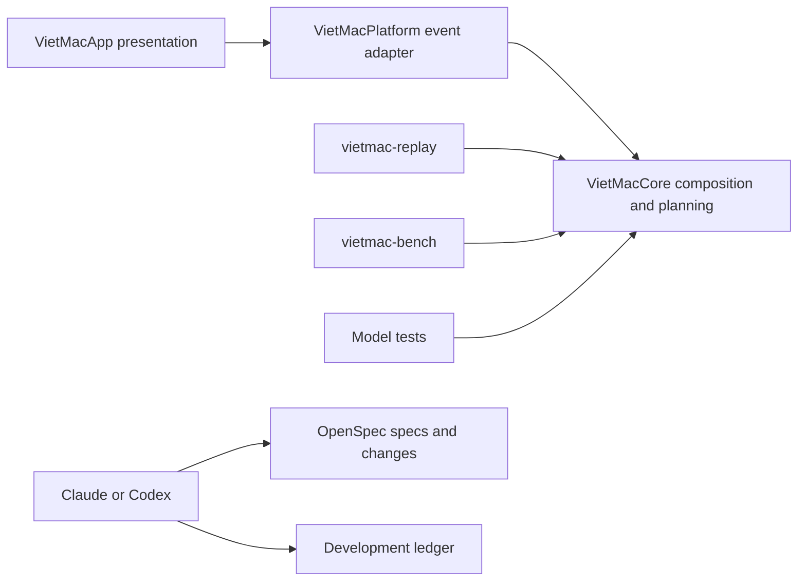
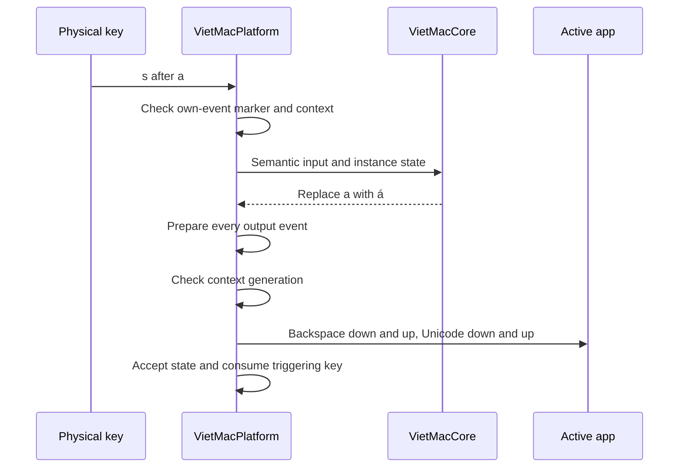

# VietMac architecture

The runtime consists of a reusable Swift core, a macOS adapter, and a small menu bar app.
Development replay, benchmarks, OpenSpec, and the ledger remain outside the runtime dependency graph.

## Delivered boundaries

| Boundary | Responsibility | Current state |
| --- | --- | --- |
| `VietMacCore` | Semantic input contracts and bounded Unicode replacement plans | Planner implemented. Telex reducer pending. |
| `VietMacPlatform` | macOS capabilities, event normalization, context, lifecycle, and transport | M0 tap/transport implementation and synthetic tests exist. Native acceptance pending. |
| `VietMacApp` | Menu and settings, bundle identity, startup | Prototype controls and read-only diagnostics build. Launch/process smoke passed; UI and native typing unverified. |
| `vietmac-replay` | Synthetic expected plans and text reconstruction | Six fixtures implemented. No live keyboard input. |
| `vietmac-bench` | Release timing with explicit scope | Planner microbenchmark implemented. Callback collection exists; native Release capture pending. |
| `ledger` | Decisions, verification, and handoffs | Append-only development records and validation implemented. |

The core imports Foundation for Unicode normalization, but no UI or event frameworks.
The future Telex reducer has instance-local state. It returns the complete desired tracked word.
The macOS adapter computes an edit, prepares generated events, checks context, and sends them in order.

## Core contracts

`CompositionInput` separates semantic text, Backspace, boundaries, and invalidation from physical macOS events.
`ContextToken` identifies the adapter's context generation.
`CompositionIntent` returns pass-through or explicit previous and desired text with a context token.
These types establish a boundary. They do not implement composition.
M0's `PrototypePipeline` lives in the platform module and implements only its two transport examples.
The production reducer will replace those example rules after the native gate passes.

`ReplacementPlan.compute` finds a common grapheme prefix and returns a suffix deletion count and insertion string.
It accepts NFC text with a logical limit between 1 and 64.
It also limits encoded length before normalization, including long combining sequences.
No code truncates a word and transforms a disconnected suffix after overflow.

Deletion count and UTF-16 output length have different meanings.
The planner test includes an emoji to detect accidental UTF-16 deletion counting.
The planned engine tracks generated Vietnamese letters only. Emoji and pasted text invalidate composition.

The current planner uses small character arrays and bounded linear work.
Measure this implementation before replacing it with custom storage.
Later reducer state can reuse fixed-capacity or reserved buffers when profiling shows a useful improvement.

## Planned event path

Use one owning run loop for mutable composition and transport state.
Do not add async tasks, actors, or external services to the per-key path.
Settings enter the path as an immutable configuration snapshot.

Generated events carry a per-process marker.
The host allows those events through without composition and handles consumed physical key-up pairs explicitly.
Prepare all output before deleting text. If preparation fails, invalidate state and preserve ordinary typing.

Event posting has no document acknowledgement and is not atomic.
A successful post cannot prove that a client displayed the payload.
Autocompletion, selected suggestions, programmatic focus, and app edits can invalidate a predicted suffix.
The native prototype must establish transport behavior in each required field family.

## Context policy

Reset on app changes, observed field/caret changes, navigation, selection, paste, cut, undo, input-source changes, and lifecycle loss.
Do not condition these resets on a smart language-switching option.
Keep composition only for the current tracked word.
Backspace outside that word does not restore previous-word state for the MVP.

The initial trial uses tested apps and ABC or U.S. input sources.
Pass through unsupported contexts, secure input, unknown layouts, and non-ASCII input conservatively.
Programmatic focus changes can remain unobserved. Do not claim a PID check solves that uncertainty.

The M0 host currently caches frontmost app, input source, focused-element identity, and selected UTF-16 range on its main run loop outside the key callback.
Accessibility focus/selection notifications and periodic inspection invalidate detected mismatches; no document text is read or persisted.
These observations do not guarantee detection of a programmatic edit that leaves the same caret or of a focus change before its notification arrives.
Task 2.2 remains pending until external-edit handling and the corresponding native reproductions are resolved.
App menus and diagnostics consume status outside the callback. Timing storage is a fixed 1,024-sample ring, with sorting/JSON export outside the callback.

## Reuse and extensions

Keep one Swift package and add capabilities within these boundaries:

- VNI adds a semantic reducer mode and fixtures, without changing the transport protocol.
- Browser compatibility adds a measured adapter profile, without changing language rules.
- Per-app preferences change configuration snapshots, without sharing composition across fields.
- Macros require a separate confirmed scope and exact boundary behavior.

Do not introduce an extension registry before a concrete extension needs one.
No runtime ledger, plugin service, database, or agent orchestrator is necessary for these extensions.
The development ledger supports agent continuity without entering the keyboard path.

## Implementation sequence

1. M0 proves native transport and context behavior through the prepared OpenSpec change.
2. M1 implements the complete Telex reducer and typed letter/shape/tone state.
3. M2 integrates the engine with reset policy, shortcut, app profiles, and minimal settings.
4. M3 verifies personal packaging, signing identity, permissions, sleep/wake, and opt-in startup.

The shell and planner do not complete M0. Native acceptance tasks remain unchecked.
The planned [Telex input MVP change](../openspec/changes/telex-input-mvp/proposal.md) groups M1 through personal M3 acceptance,
with explicit [language behavior](../openspec/changes/telex-input-mvp/specs/telex-composition/spec.md),
[mode controls](../openspec/changes/telex-input-mvp/specs/input-mode-control/spec.md),
[native/model acceptance](../openspec/changes/telex-input-mvp/specs/telex-mvp-acceptance/spec.md),
and [performance additions](../openspec/changes/telex-input-mvp/specs/performance-measurement/spec.md).
It does not bypass the M0 gate or add implemented capabilities to the table above.
The [performance policy](performance.md) defines measurement scopes and provisional budgets.
