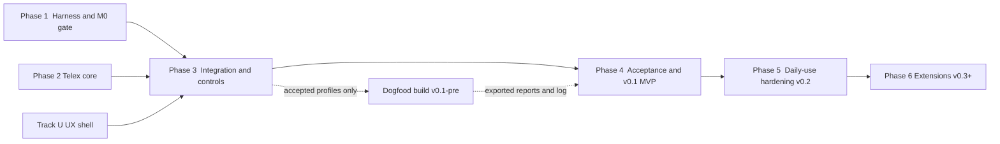

# VietMac product roadmap

Status: proposed, written 2026-11-12 from repository state at commit `9458aa9` and ledger records through 2026-10-15. Revised the same day by the product owner to add the user experience, then reconciled with the rewritten [architecture-spec.md](architecture-spec.md).
Structure and decisions are in [architecture-spec.md](architecture-spec.md). The user experience is in [ux-spec.md](ux-spec.md). Requirements and tasks stay in `openspec/changes`.
This roadmap orders outcomes and states their exit evidence. It carries no calendar dates; phases are sized S, M, or L relative to each other.

## 1. Product

**Outcome:** Son types Vietnamese on macOS all day, in the apps he uses, without lost text, duplicated text, wrong tone forms, or a composition underline.

**User:** one person, Son, on one Mac (arm64, macOS 27). Public distribution is not a goal of the MVP.
The UI is still designed so a second person given a build can set it up without help ([ux-spec.md](ux-spec.md) section 2.2).

**Experience bar:** easy to use and friendly. A new user reaches correct Vietnamese typing without documentation. Every state is visible in the menu bar, and every pause has a plain-language reason and one next step.

**Why not an existing tool:** OpenKey loses text on key rollover, duplicates text around suggestions, and does heavy work in its key callback (analysis in [openkey-comparison.md](research/openkey-comparison.md)). Apple's Telex uses marked text, which Son rejects.

**Principles**

1. Leave text literal when ownership is uncertain. A missed transformation is acceptable; a damaged document is not.
2. One convention, no options, until daily use shows a need.
3. A field is supported only after native evidence in that field.
4. English mode is explicit. The app does not guess the language.
5. No typed content leaves the key path or is stored.
6. The UI shows state and never interrupts typing. No window, sound, or notification opens because of a status change during a session.

**MVP scope:** Telex, NFC Unicode, Vietnamese/English toggle with optional shortcut, pause reasons, exclusions, opt-in login startup, seventeen field groups in VS Code, Chrome, Dia, Safari, and Apple Notes. The seventeen groups map to ten runtime profiles (architecture-spec section 6.4).
VS Code editor and quick input are in v0.1 only if final-gate item FG-1 finds a safe option. Otherwise they are recorded as excluded groups and stay literal.
UI scope: guided setup, a menu bar item with `VI` / `EN` / standby / blocked states, plain-language reasons in Vietnamese and English, a three-tab Settings window, a mode HUD for the shortcut, and short in-app Help ([ux-spec.md](ux-spec.md)).

**Not in the MVP:** VNI, macros, spelling or invalid-word restoration, automatic language detection, alternative tone placement, terminals, legacy encodings, updater, public release.

## 2. Where the project is

| Change | Tasks | State |
| --- | --- | --- |
| `macos-transport-spike` (M0) | 5 of 11 | Host, transport, context policy, and callback timing done. Native acceptance 3.1–3.6 open |
| `native-test-automation` | 7 of 15 | Driver scripts, oracles for browsers and VS Code, preservation checks, catalog of 10 scenarios done. Interference guard, Notes oracle, matrix runner, full run open |
| `telex-input-mvp` (M1–M3) | 0 of 24 | Planned. No reducer exists |

Verified so far:

- Ordered Backspace-plus-Unicode replacement works in Chrome, Dia, and Safari page fields, including key rollover and a 1,368-event workload with 36 of 36 replacements.
- Context invalidation works for external edits, same-app focus switches, and selections in those three browsers.
- Callback own-work p99 is 47.5–62.2 µs against a 2 ms budget.
- The app runs only two example rules (`as` → `á`, `aa` → `â`). It is not usable for typing.

Native matrix: 0 of 17 field groups complete, 7 partial (browser page fields), 10 not run (three address bars, two rich-editing fields, three VS Code fields, two Notes fields).

Findings that shape the plan:

- The VS Code editor and quick input give no usable Accessibility metadata in default mode, so the current policy cannot transform there. What they report in screen-reader mode is unknown (U-1, FG-1).
- Address bars show inline completions as selections, and the word stays literal while a completion is shown (decided: AD-11).
- Uncommitted work in the tree adds an `interference-probe` scenario for harness task 1.3. It needs Son to move the mouse during a run.

The last ledger record is 2026-10-15. Nothing has been recorded for four weeks.

UI today: the `ux-shell` status menu (`VI` / `EN` title with template badges, Vietnamese and English copy, Debug simulator) over the M0 host through `M0StatusAdapter`. Setup, Help, Settings, and the mode HUD exist (**verified** by build and offscreen snapshots; native checks pending, `docs/verification/ux-shell-manual-test.md`).

## 3. Roadmap

Phases 1 and 2 run in parallel if Son accepts FG-2. Otherwise Phase 2 follows Phase 1.
Track U runs beside Phase 2. It touches only `Apps/VietMac` and renders `RuntimeStatus` values built by a Debug simulator.

### Phase 1 — Finish the harness and close the M0 gate (M)

Changes: `native-test-automation` tasks 1.3, 2.4, 3.2–3.4, 4.1–4.3; `macos-transport-spike` tasks 3.1–3.6.

Order:

1. Commit or discard the pending `interference-probe` work; run it with Son (harness 1.3).
2. Matrix runner and `m0` scenario families (harness 3.2, 3.3).
3. Notes oracle; Son creates the `VietMac Test` note once (harness 2.4).
4. VS Code reproduction (M0 3.2) with the observation trace, in default mode and in screen-reader mode (U-1). Son decides FG-1 from that record.
5. Address bars, rich editing, Notes rows; lifecycle checks by hand (M0 3.3–3.5). Run U-3 first in this phase: a revoke that stalls the keyboard blocks the dogfood build. Record U-2 (is Input Monitoring needed) and U-3 (are grant changes seen without relaunch); both change the setup flow.
6. Full matrix, physical spot checks, ledger record (harness 4.x, M0 3.6).

Exit evidence: every one of the 17 groups has a recorded result with the two prototype rules; each failure has a reproduction and a decision; the matrix reruns with one command per app; U-1, U-2, and U-3 have recorded answers.

Needs from Son: Input Monitoring for the driver, the test note, a VS Code test workspace session in both modes, physical spot checks, decision FG-1.

### Phase 2 — Telex core, M1 (L)

Change: `telex-input-mvp` tasks 2.1–2.8. Pure `VietMacCore` work: typed word state, renderer, tone placement, escape, Backspace, replay fixtures, randomized checks, reducer benchmark.

Before it starts under FG-2: amend the change's "Native transport prerequisite" requirement, design, and task 1.1 so the native gate blocks integration (tasks 3.x) instead of core work. Run U-4 and U-5 early; they can change the Core contract.

Exit evidence: all `telex-composition` scenarios pass per event in replay; selected OpenKey regression families pass; sanitizer run clean; reducer p99 < 1 ms in Release.

Needs from Son: his concrete wrong-tone examples from OpenKey, to become fixtures.

Why this can run beside Phase 1: it touches no native code, and the risk the gate guarded — whether event replacement works at all without an underline — is retired for the browser page fields. Integration stays gated.

### Track U — UX shell on simulated states (S–M, beside Phase 2)

Source: [ux-spec.md](ux-spec.md). Before code: update the `input-mode-control` spec and tasks 3.3, 3.4 with the status classes, setup, and Settings, and adopt the status interface in architecture-spec section 7.2.

Outcomes: Vietnamese and English string tables for every surface; menu bar title states and menu structure; the reason table; setup steps driven by the status (step list derived, not fixed); Settings with the General, Apps, and Status tabs; mode HUD; Help pages; a Debug-only simulator that builds `RuntimeStatus` values and never calls `InputHost`.

Exit evidence: UX-1 to UX-5, UX-8, UX-12, UX-13, UX-17, UX-18, UX-20, UX-22 pass against the simulator and real grant changes; screenshots of every state in light and dark appearance saved as evidence; no change to `VietMacPlatform` input behavior.

Needs from Son: FG-3 before the setup buttons call the request functions. Until then they open the pane only.

### Phase 3 — Integration and controls, M2 (M)

Change: `telex-input-mvp` tasks 3.1–3.5, with the field-profile shape and status interface from architecture-spec sections 6.4 and 7.2 (AD-10, AD-12) written into the change's design and specs first.

Outcomes: `PrototypePipeline` removed; reducer drives the M0 transport; case from event text; ten field profiles replace the app allowlist; menu mode, status classes, shortcut, preferences, single instance, login startup.
UX outcomes: the Track U shell renders the real `RuntimeStatus`; Standby and Blocked reasons with app names and field kinds reach the menu; exclusions from the menu; Settings › Apps reads the profile table; the try-it field profile if FG-5 is accepted and U-6 passes.

Exit evidence: synthetic platform traces for ordered events, stale and partial-send handling, shortcut pairing; `make check` and `make app` pass.
UX exit evidence: UX-6, UX-7, UX-9 to UX-11, UX-14 to UX-16, UX-19, UX-23 pass in the Release bundle; the gate-combination test shows the status and the callback gate never differ (architecture-spec section 7.2).

**Dogfood build (v0.1-pre), FG-4:** enable only profiles whose full-engine matrix rows passed, by native automation and a physical spot check, for every group the profile covers. M0 two-rule rows do not qualify. The browser `webText` profiles are expected first, because their page-field transport is already verified with the prototype rules. Son types real Vietnamese there while the remaining profiles are accepted.
The dogfood build ships the real setup, menu, and reason copy, not the M0 developer menu, so the UI is tested by daily use at the same time. Profiles not yet accepted show the Standby state "not available here". Son keeps a short content-free log of moments where he could not tell why a word did not change, and exports a diagnostic report at the end of each week.

### Phase 4 — Native acceptance and v0.1 MVP, M3 (L)

Change: `telex-input-mvp` tasks 4.1–4.8, 5.1, 5.2.

Outcomes: full-engine matrix in all 17 groups by automation plus physical spot checks; lifecycle (sleep/wake, capability loss, secure input, relaunch); daily-use failure families; Release reducer and callback measurements; stable personal bundle with login startup.

Exit evidence (release criteria for v0.1):

- 17 of 17 groups pass, or a group is explicitly excluded by Son with the reason recorded (for example VS Code editor and quick input under FG-1 option C).
- No unresolved text-loss or duplicated-text reproduction.
- Reducer p99 < 1 ms and callback p99 < 2 ms on this Mac.
- README states delivered behavior; changes archived through OpenSpec.
- All UX acceptance criteria in [ux-spec.md](ux-spec.md) section 12 pass in the Release bundle, in both UI languages, in light and dark appearance.
- One moderated cold-start session with a second person on a clean user account: first transformed word in under 5 minutes, with no help.
- Every status seen during the matrix and dogfood use showed a reason and an action from the reason table; none showed a raw enum string.

### Phase 5 — Daily-use hardening, v0.2 (M, driven by use)

Entry: Son uses v0.1 as his only Vietnamese input for two weeks, OpenKey quit.

Work is chosen from evidence, not planned in advance:

| Signal | Likely work |
| --- | --- |
| High literal-fallback rate in a field | Observation timing, or a profile adjustment |
| Literal words in address bars are annoying | `selectionAware` transport (AD-11 review, U-12) |
| Apps outside the five are used often | New field profiles with matrix rows |
| A tone or escape result surprises Son | New fixture, then a rule fix |
| Any `transportUncertain` pause | Reproduction and root cause before anything else |
| Son cannot tell why a word stayed literal | Copy or Help change first; a runtime change only with a privacy-safe word-start rule |
| The standby badge in unsupported apps feels noisy | Show the badge only in the five supported apps |
| The mode HUD feels noisy | Add a setting to turn it off |
| The suggested shortcut conflicts with an app command | Change the suggestion; keep the user's chord |
| VS Code was excluded in v0.1 and Son wants it | Revisit FG-1 options with new evidence |

Exit evidence: two further weeks with zero text loss or duplication and no unexplained pause.

### Phase 6 — Extensions, v0.3 and later (each S–M)

Candidates, in suggested order. Each needs its own OpenSpec change and Son's go-ahead.

1. Invalid-word restoration for English words typed in Vietnamese mode (largest daily-use gain for mixed typing; needs a raw-key ownership contract).
2. Per-app mode memory.
3. Terminal support, if a safe profile exists.
4. Macros.
5. VNI and an alternative tone-placement setting.
6. Public distribution: Developer ID, notarization, updates, Intel and older macOS verification.

## 4. Success measures

All are content-free and come from existing counters, the matrix, or observation.

| Measure | Target for v0.1 | Source |
| --- | --- | --- |
| Text loss or duplication in accepted fields | 0 | Matrix, `replacementsUnconfirmed`, Son's reports |
| Field groups accepted | 17 of 17, or excluded by Son with a reason | Native matrix |
| Semantic fixtures passing | 100% | `vietmac-replay` |
| Literal-fallback rate while typing | Measured and reported per browser engine; target set after the first dogfood week | `unsettledTriggers` ÷ (`replacementsPosted` + `unsettledTriggers`) |
| Callback own-work p99 | < 2 ms | Callback export |
| Reducer p99 | < 1 ms | `make bench-engine` |
| Matrix flake rate | 0 failures in 5 repeats for transport and context families | Matrix runner |
| Time to first transformed word, cold second user | < 5 min, no help | Moderated session (ux-spec section 13) |
| Statuses without a plain-language reason and action | 0 | UX-8, dogfood log |
| Pauses Son cannot explain from the menu alone | 0 per week by the end of Phase 5 | Son's content-free dogfood log |
| UX acceptance criteria passing | All in ux-spec section 12 | Acceptance run |
| Blocked statuses per week, by reason | Reported; `transportUncertain` 0 | Sum of the diagnostic reports Son exports; counters are in memory per process |

UX measures are recorded by observation or from reports Son exports. No typed text, key identity, or field value is recorded, nothing is written automatically, and nothing is sent off the Mac.

## 5. Final gate for Son

One list for both documents. Details: architecture-spec section 12 and ux-spec section 16.

Son's answers, 2026-11-12: FG-2 yes, FG-3 yes, FG-4 yes with the stated conditions. FG-1 waits for U-1 and FG-5 waits for U-6.
FG-1: Son chose C on 2026-11-14, then B (`eventOnly`) on 2026-11-15. Implemented 2026-11-16 for the editor only, as the `vscodeEditor` profile: VS Code's default-mode text area whose description starts with "The editor is not accessible" (English UI). Quick Open reports caret and length, so it stays an observed field. Native acceptance pending.
The OpenSpec changes carry these answers: `telex-input-mvp` (amended), `macos-transport-spike` (tasks 3.0 and 3.2), and the new `ux-shell`.

| ID | Decision | Blocks | Recommendation (architect and product owner agree) |
| --- | --- | --- | --- |
| FG-1 | VS Code editor and quick input | Phase 1 exit, VS Code scope in v0.1 | Run U-1 first. A1 (Son turns on VS Code screen-reader mode, VietMac stays `observed`) if the metadata follows typing and Son accepts the editor changes. Otherwise C: literal in v0.1, recorded as two excluded groups. B (`eventOnly`) only if Son asks for it after reading its limits |
| FG-2 | Start the Telex core before the M0 native gate closes | Phase 2 start | Yes, after amending the change so the gate blocks integration instead. Start Track U at the same time |
| FG-3 | Let a setup button call the system permission-request functions | Track U setup | Yes. Only on a click; the system asks, Son grants |
| FG-4 | Dogfood build before all seventeen groups pass | Phase 3 | Yes, with only full-engine accepted profiles and the real UI, and only after U-3 (grant revoke with the tap installed) has a recorded safe result |
| FG-5 | VietMac's own try-it field as an eighteenth acceptance row | Setup try-it step, Phase 4 matrix | Yes if U-6 passes; otherwise try in Notes |

Decided without Son (recorded for review, not for approval):

| ID | Decision | Owner |
| --- | --- | --- |
| AD-10 | Field profiles replace `trialApps`; `observed` is the only level built in v0.1 (was OD-3) | Architect |
| AD-11 | Address bars stay `observed`; words stay literal while a completion is shown; no `selectionAware` in v0.1 (was OD-2) | Architect |
| PD-1 | Shortcut stays unset by default; setup offers one suggested chord after a native conflict check in the five apps (was G-3) | Product owner |
| PD-2 | The standby badge shows in unsupported apps and fields; revisit in Phase 5 if noisy (was G-4) | Product owner |
| PD-3 | A login-item launch with a missing grant opens no window; the menu bar shows the blocked state | Product owner |

## 6. Roadmap risks

| Risk | Effect | Response |
| --- | --- | --- |
| VS Code cannot be made safe at any assurance level | The most-used app has no support in v0.1 | Run U-1 early in Phase 1 step 4; option C is an honest fallback, shown as "not supported yet" in the UI |
| Native sessions need Son's time (grants, spot checks, idle Mac) | Phase 1 and 4 stall | Batch the asks per session; automation covers the repeatable part |
| Full Telex raises replacements per word and exposes observation lag | More literal words than with two rules | Dogfood build measures it before Phase 4 |
| macOS or browser update changes behavior mid-project | Matrix evidence goes stale | Versions recorded per run; rerun the matrix before each release |
| Scope growth before v0.1 | MVP slips | Phase 6 items stay out until Phase 5 exit |
| Setup flow depends on unknowns U-2, U-3, U-6, U-9 | Steps appear, disappear, or fall back | Setup is derived from the status; each unknown has a fallback in ux-spec |
| Many literal words read as "VietMac is broken" | Son or a second user stops trusting the app | Setup tip, Help page, dogfood log; offset-0 word start (AD-18) helps empty fields |
| Vietnamese macOS pane names differ from the copy | Setup instructions point to the wrong label | Check on a Vietnamese system before v0.1 (UX-20) |

## 7. Next action

Run Phase 1 step 1: finish harness task 1.3 with the pending `interference-probe` scenario, then build the matrix runner (harness 3.3).
In the same session, record Son's answers to FG-2 and FG-3 so Phase 2 and Track U can start. FG-1 waits for U-1; FG-5 waits for U-6.
