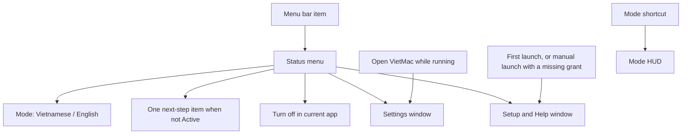

# VietMac UX and UI specification

Status: proposed, written 2026-11-12 by the product owner from repository state at commit `9458aa9`, then reconciled the same day with the rewritten [architecture-spec.md](architecture-spec.md).
Scope: the MVP app (v0.1) and the dogfood build before it.
Owner: product owner. Structure, the status interface, and runtime guarantees are owned by the architecture spec (sections 6.1, 7.2–7.10); behavior requirements stay in `openspec/changes/telex-input-mvp/specs`.
Delivery order is in [product-roadmap.md](product-roadmap.md).

Claims that affect a decision carry a label: **verified** (evidence in the repository), **inferred**, or **unknown**.
`AQ-n` are the product owner's questions to the architect, answered in architecture-spec section 7.10. `U-n` are the architecture's unknowns (section 14). `FG-n` are the final-gate items for Son (section 16). Every UI element that depends on an open unknown has a stated fallback.

## 1. Product bar for the UI

1. A new user reaches correct Vietnamese typing without reading documentation.
2. Every state is visible. Every pause has a plain-language reason and one next step.
3. Text safety outranks coverage. The UI never offers a way around a Blocked state.
4. Few settings. An option exists only for a real usage need.
5. Quiet by default. A status change during typing never opens a window, plays a sound, or posts a notification. The UI shows state; it does not nag.
6. Honest. The UI never promises that a word will transform, never claims every problem is detected, and never names a field kind the runtime cannot tell apart (architecture-spec 7.10 rules 3–5).

## 2. Users and usage situations

### 2.1 Primary user: Son

- Types Vietnamese and English all day on one Mac (arm64, macOS 27) in VS Code, Chrome, Dia, Safari, and Apple Notes (**verified**, AD-7).
- Mixes languages often: Vietnamese prose, English identifiers, URLs, commands. English mode is explicit (roadmap principle 4).
- Knows Telex. Knows macOS privacy settings. Built the app.
- Rejects the composition underline (**verified**, AD-1).

| Situation | What Son needs from the UI |
| --- | --- |
| Writing Vietnamese prose in a browser or Notes | Nothing. The title says `VI` and stays still |
| Switching to code or a URL mid-sentence | A fast mode switch and certainty about the current mode |
| Clicking into the middle of existing text | Type at once; letters typed after a click inside a word form a word of their own |
| Typing in an app or field outside the supported set | See at a glance that VietMac is not working there |
| Typing in VS Code | Know whether VS Code is supported in this build, and what it needs (FG-1) |
| After a rebuild, OS update, or reinstall | A clear signal if a grant was lost; no silent failure |
| A safety pause during typing | A calm message, the word to check, and one action to resume |

### 2.2 Second user (design target for "friendly")

The MVP is personal (**verified**, roadmap section 1). The UI is still designed so a second person, for example a family member or colleague, can install a build Son gives them and start without Son's help.

| Difference from Son | UI consequence |
| --- | --- |
| Does not know what the macOS grants are | Setup explains each in one sentence and opens the exact pane |
| May have OpenKey, EVKey, or GoTiengViet running | Setup shows a conflict step when the runtime detects an active tool (U-9); otherwise a static line in the welcome step |
| May use Apple's Vietnamese input source by default | Setup shows the current source and how to select ABC |
| May not know Telex | Try-it step and Help show a one-line Telex reference |
| Has a build with a different signature | Grants do not carry over; the stale-entry help is shown (section 4.6) |
| May use VoiceOver or Increase Contrast | Section 11 applies to every screen |
| Uses apps outside the five | The "not available here" state must be obvious and unalarming |

What would change for a public release (out of scope): Developer ID signing, update flow, a broader app list, and a support page. None of these is designed here.

## 3. Information architecture



Four surfaces only: menu bar item, status menu, Setup and Help window, Settings window. Plus one transient HUD for shortcut mode changes.
No Dock icon (`LSUIElement`, **verified**). No notifications (they need another permission). No popover.
Every visible state is built from `RuntimeStatus` (architecture-spec 7.2) and the shell's own preferences. Nothing else.

The menu is the complete control. The shortcut is a convenience: it cannot fire while the event tap is absent, which happens when a grant is missing, secure input is on, or a sticky pause is active (architecture-spec 6.6). Every action the shortcut does is also in the menu.

## 4. Setup (first-run onboarding)

### 4.1 Goal and measure

From first launch to the first correctly transformed word, with no documentation.
Target for a cold second user: under 5 minutes and no outside help (measured in a moderated session, section 13).

### 4.2 Window

- Title: `Thiết lập VietMac` / `Set Up VietMac`.
- Fixed size about 560 × 460 pt, centered on the active screen, standard title bar with a close button.
- Opens by itself only at launch, under the rules in section 4.6. Never because of a status change during a session.
- Layout per step: step indicator, heading, one or two short paragraphs, a status row, a primary button bottom right, `Quay lại` / `Back` bottom left, and a text link `Để sau` / `Later` where the step can be skipped.
- The step indicator counts the steps in this user's list (`Bước 3 / 6`). The list is derived at runtime (section 4.3), so the count is never hard-coded.
- Closing the window at any step is allowed. The app stays in the menu bar in its current state and the menu shows `Tiếp tục thiết lập…` / `Continue Setup…`.
- The shell stores only the last step the user saw. On reopen, setup starts at the first item still missing, in gate order (architecture-spec 7.6).

### 4.3 Step list

The list is built from the status and from settled unknowns. A step whose condition already holds still appears with its check mark, so the user sees the checklist once.

| Step | Shown when | Satisfied when |
| --- | --- | --- |
| 1 Welcome | Always | User presses `Bắt đầu` |
| 2 Input Monitoring | The `listening` gate exists. If U-2 shows the active tap does not need Input Monitoring, the gate and this step are removed | `capabilities.eventListening` |
| 3 Accessibility | Always | `capabilities.accessibility` and `capabilities.eventPosting` |
| 4 Keyboard | Always | `inputSourceID` is ABC or U.S. |
| 5 Other input tool | A known tool holds an active keyboard tap (`conflictingBundleID` set). Requires U-9 to pass; until then never shown | `conflictingBundleID` is empty |
| 6 Try it | Always; in-window field only if FG-5 is accepted and U-6 passes, otherwise the Notes variant | A transformed word (in-window) or the user's confirmation (Notes) |
| 7 Ready | Always | User presses `Xong` |

Steps follow the architecture's gate order (capabilities → source → conflicting tool), so "start at the first missing item" and the visible order agree. Numbers here are names; the visible indicator counts only the steps in this user's list.

Input Monitoring comes before Accessibility because macOS may ask the user to quit and reopen the app after an Input Monitoring change (**unknown**, U-3); doing it first means a relaunch happens before more progress. Son granted them in this order in session 2 and all three capabilities became true (**verified**, `docs/verification/macos-transport-spike.md`).

#### Step 1 — Welcome

| Element | Vietnamese | English |
| --- | --- | --- |
| Heading | Gõ tiếng Việt kiểu Telex, không gạch chân | Type Vietnamese with Telex, no underline |
| Body | VietMac đổi `tieengs` thành `tiếng` ngay khi bạn gõ. Thiết lập mất khoảng hai phút. | VietMac changes `tieengs` to `tiếng` while you type. Setup takes about two minutes. |
| Privacy line | VietMac không đọc chữ trong ứng dụng khác. VietMac không lưu và không gửi chữ bạn gõ. VietMac không dùng mạng. | VietMac does not read text in other apps. It does not store or send what you type. It does not use the network. |
| Other-tool line (only while step 5 cannot be shown, U-9) | Nếu bạn đang dùng OpenKey, EVKey hay bộ gõ tiếng Việt khác, hãy thoát nó trước. | If you use OpenKey, EVKey, or another Vietnamese input tool, quit it first. |
| Primary | Bắt đầu | Start |

The privacy line is worded so it does not cover VietMac's own try-it field, which the shell may read in memory (architecture-spec 7.10 rule 7, AQ-4). It is backed by privacy invariants 1, 2, and 5 (**verified** as design invariants).

#### Step 2 — Input Monitoring (conditional on U-2)

| Element | Vietnamese | English |
| --- | --- | --- |
| Heading | Cho phép VietMac nhận phím bạn gõ | Allow VietMac to receive the keys you press |
| Body | Bật VietMac trong **Theo dõi đầu vào**. VietMac chỉ dùng phím để đổi chữ. VietMac không ghi lại phím. | Turn on VietMac in **Input Monitoring**. VietMac uses the keys only to change letters. It does not record them. |
| Instruction | 1. Bấm nút bên dưới. 2. Bật công tắc cạnh VietMac. 3. Nếu macOS hỏi, chọn **Thoát & Mở lại**. | 1. Click the button below. 2. Turn on the switch next to VietMac. 3. If macOS asks, choose **Quit & Reopen**. |
| Primary (missing) | Mở Cài đặt Hệ thống | Open System Settings |
| Status (missing) | Chưa bật | Off |
| Status (granted) | Đã bật ✓ | On ✓ |
| Primary (granted) | Tiếp tục | Continue |
| Help disclosure | Công tắc đã bật nhưng ở đây vẫn ghi "Chưa bật"? Tắt công tắc. Sau đó bật lại. Nếu vẫn ghi "Chưa bật": 1. Chọn VietMac trong danh sách. 2. Bấm nút **−**. 3. Bấm **Mở Cài đặt Hệ thống** lần nữa. | The switch is on, but this window still shows "Off"? Turn the switch off. Then turn it on again. If the window still shows "Off": 1. Select VietMac in the list. 2. Click **−**. 3. Click **Open System Settings** again. |
| Secondary (20 s after the user returns from System Settings with the grant still missing) | Mở lại VietMac | Reopen VietMac |

Behavior:

1. With FG-3 accepted, the primary button calls the system request function, then opens the pane. The request adds VietMac to the list so the user only flips a switch. Until FG-3 is accepted, and as the fallback, the button opens the pane only and the instruction adds `Bấm **+**. Chọn VietMac trong thư mục Ứng dụng.` / `Click **+**. Select VietMac in Applications.`
2. The request runs only from that click. Never at launch, on a timer, or in the key callback (architecture-spec 7.6).
3. The runtime refreshes capabilities every 250 ms while a setup or settings window is visible (architecture-spec 7.5). A grant change reaches this step within 1 s when macOS reports it without a relaunch (U-3).
4. On success the status row turns to `Đã bật ✓`, keyboard focus moves to `Tiếp tục`, and VoiceOver announces the status. If System Settings is the frontmost app at that moment, the setup window is brought to the front; otherwise it is not. This is the only time the app raises a window on a status change, and it happens only while the user is in System Settings, not while typing.
5. No auto-advance. The user presses `Tiếp tục`.
6. `Mở lại VietMac` relaunches the app without a helper (architecture-spec 7.7, **inferred** until task 4.7) and setup reopens at the first missing item.

The app cannot tell "never asked", "denied", and "stale entry shown as on" apart (**verified** limit, architecture-spec 7.6). The copy therefore treats every missing grant the same way and carries the stale-entry help on every grant step.

#### Step 3 — Accessibility

Same layout and behavior as step 2.

| Element | Vietnamese | English |
| --- | --- | --- |
| Heading | Cho phép VietMac đổi chữ trong ô bạn đang gõ | Allow VietMac to change letters in the field you type in |
| Body | Bật VietMac trong **Trợ năng**. VietMac xem vị trí con trỏ và loại ô. VietMac không đọc chữ trong ứng dụng khác. | Turn on VietMac in **Accessibility**. VietMac checks the caret position and the kind of field. It does not read text in other apps. |
| Primary | Mở Cài đặt Hệ thống | Open System Settings |
| Extra row, only when Accessibility and Input Monitoring are on and posting is still off | Mở lại VietMac để dùng quyền bạn vừa bật. | Reopen VietMac to use the permission you turned on. |
| Extra row action | Mở lại VietMac | Reopen VietMac |

Event posting is never presented as a third switch (architecture-spec 7.10 rule 9). In session 2 it became true with the other two (**verified**); the pane that controls it is **inferred** to be Accessibility.

The body copy matches privacy invariant 2: field observation reads identity, role, range, and count, never a value (**verified** design invariant). If that changes, this copy must change.

Vietnamese pane names `Theo dõi đầu vào` and `Trợ năng` must match the Vietnamese macOS UI (**unknown** for macOS 27; UX-20).

#### Step 4 — Keyboard input source

| Element | Vietnamese | English |
| --- | --- | --- |
| Heading | Chọn bàn phím ABC | Select the ABC keyboard |
| Body | VietMac cần bàn phím ABC hoặc U.S. Bàn phím đang chọn: **`<name>`**. | VietMac needs the ABC or U.S. keyboard. Current keyboard: **`<name>`**. |
| Instruction (wrong source) | Bấm biểu tượng bàn phím trên thanh menu. Chọn **ABC**. | Click the keyboard icon in the menu bar. Select **ABC**. |
| Instruction (ABC not in the list) | Thêm **ABC** trong Cài đặt Hệ thống › Bàn phím › Nguồn nhập. | Add **ABC** in System Settings › Keyboard › Input Sources. |
| Primary (wrong source) | Mở cài đặt Bàn phím | Open Keyboard Settings |
| Status | ABC ✓ / `<name>` ✗ | ABC ✓ / `<name>` ✗ |

VietMac never switches the input source (**verified** constraint). The shell resolves `inputSourceID` to its localized name.

#### Step 5 — Other Vietnamese input tool (conditional on U-9)

| Element | Vietnamese | English |
| --- | --- | --- |
| Heading | Thoát bộ gõ khác trước | Quit the other input tool first |
| Body | `<App>` cũng đang đổi chữ bạn gõ. Hai bộ gõ cùng lúc sẽ đổi chữ hai lần. Hãy thoát `<App>` từ biểu tượng của nó trên thanh menu. | `<App>` also changes what you type. Two input tools change your text twice. Quit `<App>` from its menu bar icon. |
| Status row | `<App>` đang chạy → `<App>` không còn chạy ✓ | `<App>` is running → `<App>` is not running ✓ |
| Primary | Tiếp tục (enabled after the conflict clears) | Continue |
| Link | Để sau | Later |

VietMac never quits another app (architecture-spec 7.10 rule 8). The step is shown only for a known tool that holds an active keyboard tap; a bundle ID alone is not enough, because OpenKey's helper stays alive without a tap (**verified**, sessions 3–5).

#### Step 6 — Try it

In-window variant (FG-5 accepted and U-6 passed):

| Element | Vietnamese | English |
| --- | --- | --- |
| Heading | Thử gõ tiếng Việt | Try typing Vietnamese |
| Mode control | Công tắc `Tiếng Việt` (off on arrival) | Switch `Vietnamese` (off on arrival) |
| Instruction | 1. Bật **Tiếng Việt**. 2. Bấm vào ô bên dưới. 3. Gõ: `tieengs Vieetj` | 1. Turn on **Vietnamese**. 2. Click the field below. 3. Type: `tieengs Vieetj` |
| Expected | Kết quả đúng: **tiếng Việt** | Correct result: **tiếng Việt** |
| Field placeholder | Gõ ở đây | Type here |
| Success | Đúng rồi. VietMac đã sẵn sàng. | Correct. VietMac is ready. |
| Not transforming (after two spaces with no transformation) | Chữ chưa đổi? Bấm biểu tượng VietMac trên thanh menu. Dòng đầu cho biết lý do. | The text did not change? Click the VietMac icon in the menu bar. The first line gives the reason. |
| Primary | Tiếp tục | Continue |
| Link | Bỏ qua | Skip |

Notes variant (fallback):

| Element | Vietnamese | English |
| --- | --- | --- |
| Instruction | 1. Bật **Tiếng Việt**. 2. Mở một ghi chú mới. 3. Gõ: `tieengs Vieetj` | 1. Turn on **Vietnamese**. 2. Open a new note. 3. Type: `tieengs Vieetj` |
| Button | Mở Ghi chú | Open Notes |
| Confirm | Chữ đã đổi | The text changed |
| Didn't work | Chữ chưa đổi | The text did not change → shows the current status line and its action |

Both variants show the Telex strip: `s` sắc · `f` huyền · `r` hỏi · `x` ngã · `j` nặng · `aa` â · `aw` ă · `ee` ê · `oo` ô · `ow` ơ · `uw` ư · `dd` đ.

Rules:

- First launch is English mode (**verified** spec requirement). The switch here is an explicit user action and calls the same `setMode` as the menu.
- The in-window success check compares the shell's own field value with the sample in memory; nothing is stored (AQ-4 answer). The in-window field is an ordinary `observed` profile with its own matrix row.
- The sample starts in an empty field; the first word transforms without a leading space (AD-18). The success check accepts `tiếng Việt` with or without a leading space.
- The copy names the correct result and never says "VietMac will": the UI does not promise a transformation (architecture-spec 7.10 rule 3).

#### Step 7 — Ready

| Element | Vietnamese | English |
| --- | --- | --- |
| Heading | VietMac đã sẵn sàng | VietMac is ready |
| Where the icon is | VietMac nằm trên thanh menu. **VI** là tiếng Việt. **EN** là tiếng Anh. Mọi thao tác đều có trong menu đó. | VietMac is in the menu bar. **VI** means Vietnamese. **EN** means English. Every action is in that menu. |
| Shortcut label | Phím tắt đổi tiếng Việt / tiếng Anh (không bắt buộc) | Shortcut to switch between Vietnamese and English (optional) |
| Shortcut control | Shortcut recorder, empty, with button `Dùng gợi ý: <chord>` | `Use the Suggestion: <chord>` |
| Login checkbox | ☐ Mở VietMac khi đăng nhập | ☐ Open VietMac at login |
| Tip | Mẹo: nếu bạn bấm chuột vào giữa một từ rồi gõ tiếp, VietMac coi các chữ mới là một từ riêng. | Tip: if you click inside a word and keep typing, VietMac treats the new letters as a separate word. |
| Hidden icon | Không thấy biểu tượng? Mở VietMac lần nữa từ Launchpad hoặc Spotlight. | You cannot see the icon? Open VietMac again from Launchpad or Spotlight. |
| Primary | Xong | Done |

- Login startup stays off until the user checks it (**verified** spec). The checkbox shows the system registration state inline (section 7.2).
- The shortcut stays unset unless the user records one or presses `Dùng gợi ý` (PD-1, section 6.2).
- The icon line includes a small rendered sample of each title state.
- Opening VietMac again while it runs opens Settings (architecture-spec 7.7).

### 4.4 Denial and skip

| User action | Result |
| --- | --- |
| Returns from System Settings without turning the switch on | Status stays `Chưa bật`; help disclosure becomes visible; no alert |
| Presses `Để sau` on a grant step | Window closes. Title shows the blocked badge. Menu shows the missing grant and `Tiếp tục thiết lập…` |
| Closes the window | Same as `Để sau` |
| Turns a grant off later in System Settings | Title changes to blocked as soon as the capability read turns false (immediate publication; whether macOS reports a revoke without relaunch is U-3). No window opens |
| Denies at a macOS prompt, if one appears | Same as not turning the switch on |

### 4.5 Detection summary

| Condition | Status field | Refresh |
| --- | --- | --- |
| Input Monitoring, Accessibility, posting | `capabilities` (reported in every mode) | 250 ms while Vietnamese mode or a setup or settings window is visible; slower otherwise (architecture-spec 7.5) |
| Input source | `inputSourceID` | Source-change notification and refresh (**verified** in M0) |
| Other input tool | `blocked(conflictingTool)`, `conflictingBundleID` | Refresh, outside the key path (U-9) |
| First transformed word | Shell's own try-it field | On each edit of that field |
| Setup complete | All required `capabilities` true, `inputSourceID` ABC or U.S., and `conflictingBundleID` empty. Read from these fields, not from `.blocked`, because first launch is English mode and its availability is `.off` (AQ-20) | Derived (architecture-spec 7.6) |

### 4.6 When setup opens by itself

| Launch | A required item is missing | Behavior |
| --- | --- | --- |
| First launch ever | — | Setup opens at step 1 |
| Manual launch (Finder, Spotlight, Launchpad, `open`) | Yes | Setup opens once at the first missing item, with the update heading below |
| Login-item launch | Yes | **No window** (PD-3). The title shows the blocked badge; the menu shows the reason and `Tiếp tục thiết lập…` |
| Any launch | No | No window |

Reason for PD-3: a login launch is not a user action. A window right after login takes focus while the user starts typing, which breaks product bar item 5. The blocked badge is visible, and the first manual launch or menu click leads to setup.
The shell needs to tell a login launch from a manual one (AQ-16). Until U-15 (architecture-spec section 14) shows the shell can tell them apart, the fallback applies at every launch: at any launch with a missing item after setup was completed once, show the setup window without activating the app, so it never takes keyboard focus.

Update heading and body (manual launch after setup was completed): `Hãy bật lại quyền cho VietMac` / `Turn On the VietMac Permission Again`; `Sau khi cập nhật, macOS có thể không nhận ra VietMac. Tắt công tắc. Sau đó bật lại. Nếu chưa được, hãy xoá VietMac khỏi danh sách. Sau đó thêm lại.` / `After an update, macOS may not recognize VietMac. Turn the switch off. Then turn it on again. If that does not help, remove VietMac from the list. Then add it again.`
Builds signed with the trusted `VietMac Local Signing` certificate keep grants across rebuilds (**verified**, sessions 3–5). Ad hoc builds lose them at every build (**verified**). When `DiagnosticsSnapshot.signature == adHoc`, Settings › Status shows `Bản dựng này mất quyền sau mỗi lần dựng lại.` / `This build loses its permissions after each rebuild.`

## 5. Menu bar item

### 5.1 States

UI classes map one-to-one onto the architecture's availability (architecture-spec 6.1, 7.2):

| UI class | Architecture | Title | Badge |
| --- | --- | --- | --- |
| Active | `.active(_)` | `VI` | none |
| English | `.off` | `EN` | none; triangle if a capability is missing |
| Blocked (needs action) | `.blocked(reason)` | `VI` | `exclamationmark.triangle.fill` |
| Standby, shown | `.standby` with `secureInput`, `passwordField`, `unsupportedApp`, `excludedApp`, `unsupportedField` | `VI` | `pause.fill` |
| Standby, quiet | `.standby` with `noTextField`, `fieldUnreadable`, `sleeping` | `VI` | none; reason appears in the menu only |
| Word-level hold | not a status | unchanged | none; no UI at the time (Help only) |

Accessibility labels:

| Title | Vietnamese | English |
| --- | --- | --- |
| `VI` | VietMac: tiếng Việt | VietMac: Vietnamese |
| `EN` | VietMac: tiếng Anh | VietMac: English |
| `VI` + pause | VietMac: tiếng Việt, tạm dừng ở đây | VietMac: Vietnamese, paused here |
| `VI` + triangle | VietMac: tiếng Việt, cần xử lý | VietMac: Vietnamese, needs attention |
| `EN` + triangle | VietMac: tiếng Anh, có quyền chưa bật | VietMac: English, a permission is off |

Rules:

- Template rendering, system menu bar font, fixed width for `VI` and `EN` so the menu bar does not shift. State is carried by text and shape, never by color alone.
- Timing: Blocked, mode, and Active changes show immediately. A Standby badge may appear or disappear up to 500 ms late, to avoid flicker during focus changes (architecture-spec 7.4).
- `noTextField` and `fieldUnreadable` stay quiet because they occur on every click outside a text field and inside fields VietMac cannot read. A badge there would flicker all day and explain nothing the user can act on. `sleeping` is never seen while the Mac sleeps.
- The tooltip repeats the menu's status line.
- `VI` and `EN` are used in both UI languages. They are the usual labels in Vietnamese input tools (**inferred**) and fit the narrow menu bar.

PD-2 (product owner decision): the Standby badge shows in unsupported apps and fields. With five supported apps, Son will see it often. It answers "why didn't that word change" without any message, and it does not move or flash. Revisit in Phase 5 if it feels noisy.

### 5.2 Click behavior

A left or right click opens a standard `NSMenu`. No popover, no window. A native menu supports the keyboard and VoiceOver, and opening it does not activate VietMac, so the frontmost app stays the one the user was typing in (**inferred**; needed for "Turn off in `<App>`"). The menu reads `host.status` when it opens (architecture-spec 7.4).

### 5.3 Menu structure

```
Tiếng Việt: đang bật                      ← status line (disabled text)
  <detail line, only when not Active>      ← reason, secondary text
  <action item, only when one exists>      ← the one next step
─────────────
✓ Tiếng Việt                    ⌃⌥V       ← radio item; shows the shortcut while it is armed
  Tiếng Anh
─────────────
  Tắt tiếng Việt trong <App>               ← only when <App> has a profile
─────────────
  Tiếp tục thiết lập…                      ← only while setup is incomplete
  Hướng dẫn…
  Cài đặt…                        ⌘,
─────────────
  Thoát VietMac                   ⌘Q
```

English UI equivalents: `Vietnamese: On`, `Vietnamese`, `English`, `Turn Off Vietnamese in <App>`, `Continue Setup…`, `Help…`, `Settings…`, `Quit VietMac`.

Status line copy:

| State | Vietnamese | English |
| --- | --- | --- |
| `.active(.observed)` | Tiếng Việt: đang bật | Vietnamese: On |
| `.active(.eventOnly)` (only if FG-1 selects B) | Tiếng Việt: đang bật, kiểm tra giảm | Vietnamese: On, Reduced Checking |
| `.off` | Tiếng Anh: VietMac không đổi chữ | English: VietMac Does Not Change Text |
| `.standby` | Tiếng Việt: tạm dừng ở đây | Vietnamese: Paused Here |
| `.blocked` | Tiếng Việt: cần xử lý | Vietnamese: Needs Attention |

Holding Option while the menu is open reveals `Lưu báo cáo chẩn đoán…` / `Save Diagnostic Report…`. It exports only the "may show" column of architecture-spec 7.9. The M0 items (`Enable M0 prototype`, the ✓/✗ access row, the example notice) leave the normal menu.

### 5.4 Reasons: copy and next step

One row per architecture reason (architecture-spec 7.2). When several gates fail, only the first in gate order is shown: mode → capabilities → sticky pause → secure input → input source → conflicting tool → exclusion → field profile → field readability.

Blocked (Son must act):

| Reason | Detail line (VI) | Detail line (EN) | Action (VI) | Action (EN) | Action does |
| --- | --- | --- | --- | --- | --- |
| `accessibility` | Quyền Trợ năng chưa bật. | The Accessibility permission is off. | Bật quyền Trợ năng… | Turn On Accessibility… | Opens setup at step 3 |
| `listening` | Quyền Theo dõi đầu vào chưa bật. | The Input Monitoring permission is off. | Bật quyền Theo dõi đầu vào… | Turn On Input Monitoring… | Opens setup at step 2 |
| `posting` | VietMac chưa gửi phím được. | VietMac cannot send keys yet. | Mở lại VietMac | Reopen VietMac | Relaunch; if still missing, setup opens at step 3 |
| `unsupportedSource` | Bàn phím đang là `<source>`. Hãy chọn ABC. | The keyboard is `<source>`. Select ABC. | Mở cài đặt Bàn phím… | Open Keyboard Settings… | Opens Keyboard › Input Sources; never switches |
| `conflictingTool` (U-9) | `<App>` cũng đang đổi chữ bạn gõ. | `<App>` also changes what you type. | Cách thoát `<App>`… | How to Quit `<App>`… | Opens Help › Other input tools; never quits it |
| `tapUnavailable` | VietMac chưa nhận được phím. | VietMac cannot receive keys. | Thử lại | Try Again | `resume()`; after a second failure the item becomes `Mở lại VietMac` / `Reopen VietMac` |
| `userDisabledTap` | macOS đã tạm dừng việc nhận phím của VietMac. | macOS stopped the key input of VietMac. | Tiếp tục gõ tiếng Việt | Resume Vietnamese | `resume()` |
| `recoveryLimit` | VietMac tạm dừng vì máy phản hồi chậm nhiều lần. | VietMac paused because the Mac responded slowly several times. | Tiếp tục gõ tiếng Việt | Resume Vietnamese | `resume()` |
| `transportUncertain` | VietMac tạm dừng để giữ an toàn cho chữ. Hãy xem lại từ bạn vừa gõ. | VietMac paused to keep your text safe. Check the last word you typed. | Tiếp tục gõ tiếng Việt | Resume Vietnamese | `resume()`; starts with no tracked word |

Standby (clears by itself):

| Reason | Shown in title | Detail line (VI) | Detail line (EN) | Action (VI) | Action (EN) |
| --- | --- | --- | --- | --- | --- |
| `secureInput` | Badge | Một ô mật khẩu hoặc chế độ nhập an toàn đang bật. Tiếng Việt tạm dừng. | A password field or secure input is on. Vietnamese is paused. | Xem lý do… → Help › Password fields | See the Reason… |
| `passwordField` | Badge | Đây là ô mật khẩu. VietMac không đổi chữ ở đây. | This is a password field. VietMac does not change text here. | none; clears when you leave the field | — |
| `unsupportedApp` | Badge | VietMac chưa hỗ trợ `<App>`. Chữ bạn gõ được giữ nguyên. | VietMac does not support `<App>` yet. Your text stays as typed. | Xem ứng dụng được hỗ trợ… | See Supported Apps… |
| `excludedApp` | Badge | Bạn đã tắt tiếng Việt trong `<App>`. | You turned off Vietnamese in `<App>`. | Bật lại tiếng Việt trong `<App>` | Turn On Vietnamese in `<App>` |
| `unsupportedField` | Badge | VietMac chưa hỗ trợ `<Field kind>` trong `<App>`. | VietMac does not support `<Field kind>` in `<App>` yet. | Xem ứng dụng được hỗ trợ… | See Supported Apps… |
| `noTextField` | Quiet | Chưa chọn ô để gõ. | No text field is selected. | none | — |
| `fieldUnreadable` | Quiet | VietMac không kiểm tra được ô này. Chữ bạn gõ được giữ nguyên. | VietMac cannot check this field. Your text stays as typed. | none (VS Code hint below) | — |
| `sleeping` | Quiet | Máy vừa ngủ. VietMac sẽ tự chạy lại. | The Mac was asleep. VietMac starts again automatically. | none | — |

Help › Password fields (generic, no app name in v0.1, AQ-6): `Nếu không có ô mật khẩu nào đang mở, một ứng dụng khác có thể đang bật chế độ nhập an toàn (ví dụ Terminal › Nhập bằng bàn phím an toàn). Tắt chế độ đó trong ứng dụng ấy.` / `If no password field is open, another app may have secure input on (for example Terminal › Secure Keyboard Entry). Turn it off in that app.`

VS Code hint: only if FG-1 selects A1. When the resolved profile is `vscode.editor` or `vscode.quickInput` and the status is `fieldUnreadable`, the detail line reads `Bật chế độ trình đọc màn hình trong VS Code để gõ tiếng Việt ở đây.` / `Turn on screen reader mode in VS Code to type Vietnamese here.` with the action `Xem cách bật…` / `See How…` opening Help › VS Code. VietMac never changes the VS Code setting itself (architecture-spec 7.10 rule 8). This needs the profile ID with the `fieldUnreadable` reason (AQ-17).

Field-kind names in `<Field kind>` come from section 7.2 Apps table.

M0 traceability: the twelve M0 `PauseReason` cases map as follows. `accessibility`, `listening`, `posting`, `secureInput`, `unsupportedSource`, `tapUnavailable`, `recoveryLimit`, `userDisabledTap`, `transportUncertain` keep their names. `unsupportedApp` splits into `unsupportedApp`, `excludedApp`, `unsupportedField`, `noTextField`, `passwordField`. `uncertainContext` splits into word-level holds (selection, lagging observation) and `fieldUnreadable`; M0's sleep case becomes `sleeping`.

Copy rules:

- Detail line: what happened, then the consequence if not obvious. At most 70 characters in English.
- Action: a verb first. At most one action. A trailing `…` means it opens a window or System Settings.
- Never blame the user. Never say "error", "lỗi", "failed", or "thất bại" for an expected state.
- Never offer "type anyway" or an automatic resume. Resume exists only for the four sticky reasons (architecture-spec 7.10 rule 2).

## 6. Mode switching

### 6.1 Ways to switch

| Way | Works when | Feedback |
| --- | --- | --- |
| Menu radio item | Always | Title changes `VI` ↔ `EN` immediately. No HUD; the menu was visible |
| Shortcut | Only while `shortcutArmed` is true: a shortcut is set and the tap is listening | Title changes and the HUD shows |
| Try-it switch in setup | Always | Title changes |

A mode change clears the tracked word and never rewrites displayed text (**verified** spec).
The shortcut does not work while a grant is missing, during secure input, or during a sticky pause (architecture-spec 6.6, `shortcutArmed`). The status can lag by up to 250 ms after secure input turns on. In those cases the chord reaches the frontmost app as an ordinary key press. The menu stays the complete control.

When a shortcut is set but not armed, Settings › General shows under the recorder: `Phím tắt hiện chưa dùng được: <reason>. Hãy dùng menu VietMac.` / `The shortcut does not work now: <reason>. Use the VietMac menu.` The menu shows the chord beside the mode items only while it is armed.

### 6.2 Shortcut default (PD-1, product owner decision)

- The stored default stays unset, as the spec requires (**verified**). A preset chord could silently take a command in one of Son's apps.
- Setup step 7 and Settings offer one button `Dùng gợi ý: <chord>`. Recording another chord is one click away.
- The suggested chord ships only after a native conflict test in VS Code, Chrome, Dia, Safari, and Notes. Candidate: `⌃⌥V`; its conflicts are **unknown**. Avoid `⌃Space` and `⌃⌥Space`, which macOS uses for input sources by default (**inferred**).
- The recorder accepts one modifier-only gesture: ⌃⇧ pressed together and released with no other key (Son, 2026-11-15). Any other key, click, or extra modifier while ⌃⇧ is held cancels the gesture, so ⌃⇧ chords in apps still work.
- The recorder rejects a chord without Command, Control, or Option, and every other modifier-only gesture: `Thêm ⌘, ⌃ hoặc ⌥, và một phím khác. Hoặc chỉ dùng ⌃⇧.` / `Add ⌘, ⌃, or ⌥, and one other key. Or use ⌃⇧ alone.`
- A chord that matches a system shortcut is refused with `macOS đang dùng phím tắt này.` / `macOS already uses this shortcut.` (AQ-8 answer: system shortcuts only). App shortcuts cannot be detected; the native conflict test covers the suggested chord.

This was G-3. It needs no decision from Son: it keeps the spec's default and adds only an opt-in convenience. Son can still change or clear the chord.

### 6.3 Mode HUD

Shown when `mode` changed and `modeSource == .shortcut` (architecture-spec 7.3), from `onStatusChange`, never from the callback.

- Content: `Tiếng Việt` or `Tiếng Anh` (`Vietnamese` / `English`) with the `VI` / `EN` glyph.
- About 160 × 64 pt, centered horizontally, in the lower third of the screen with the key window.
- System HUD material; follows light and dark appearance.
- Shown 0.8 s. With Reduce Motion it appears and disappears without fade. Otherwise a 0.15 s fade.
- Non-activating, ignores mouse events, never becomes key. Native check: `focusChanges` must not rise while it shows (U-8). If U-8 fails, the HUD is dropped and the title change is the only feedback.
- VoiceOver: an announcement with the same text.
- No setting to disable it in the MVP. Revisit if Son reports it as noise.

### 6.4 Turn off in the current app (exclusion)

- `Tắt tiếng Việt trong <App>` appears only when the frontmost app has a profile. Exclusions are per app, never per field (architecture-spec 7.10 rule 14).
- After selecting it, that app shows the Standby badge with `excludedApp`, and the item reads `Bật lại tiếng Việt trong <App>`.
- Exclusions are listed in Settings › Apps.

## 7. Settings window

### 7.1 Opening

From the menu `Cài đặt…`, or by opening VietMac again from Finder, Launchpad, or Spotlight while it runs (architecture-spec 7.7). Standard macOS Settings window with three toolbar tabs. Remembers the last tab. Closing it changes nothing.

### 7.2 Tabs and controls

**Chung / General**

| Control | Type | Default | Notes |
| --- | --- | --- | --- |
| Phím tắt đổi tiếng Việt / tiếng Anh | Shortcut recorder with `Xoá` and `Dùng gợi ý` | Unset | Section 6.2; shows the not-armed line from 6.1 |
| Mở VietMac khi đăng nhập | Checkbox | Off | Below it, the system state (architecture-spec 7.8): `Đã bật` / `On`; `Chưa bật` / `Off`; `Hãy cho phép VietMac trong Cài đặt Hệ thống › Mục đăng nhập.` / `Allow VietMac in System Settings › Login Items.` with `Mở` / `Open`; `macOS không tìm thấy VietMac để đăng ký.` / `macOS cannot find VietMac to register it.`. Read when the window opens or becomes key |
| Bảng gõ Telex | Text link | — | Opens Help › Telex |

**Ứng dụng / Apps**

One row per supported app, from the compiled profile table (architecture-spec 6.4). Each row lists the field kinds the runtime can tell apart, not the seventeen test groups (architecture-spec 7.10 rule 5).

| App | Field kinds shown (VI / EN) | Profiles |
| --- | --- | --- |
| VS Code | Trình soạn thảo / Editor; Tìm / Find; Ô lệnh nhanh / Quick Open | `vscode.editor`, `vscode.find`, `vscode.quickInput` |
| Chrome, Dia, Safari | Thanh địa chỉ / Address bar; Ô chữ trên trang web / Text on web pages | `*.addressBar`, `*.webText` (inputs, text areas, and rich text are one kind) |
| Ghi chú / Notes | Ghi chú / Notes (title and body are one kind) | `notes.text` |

Per field kind, a state label:

| Profile state | Vietnamese | English |
| --- | --- | --- |
| Accepted, `observed` | Hỗ trợ ✓ | Supported ✓ |
| Accepted, `eventOnly` (only if FG-1 selects B) | Hỗ trợ, kiểm tra giảm ⓘ | Supported, reduced checking ⓘ |
| Accepted, needs VS Code screen-reader mode (only if FG-1 selects A1) | Cần bật chế độ trình đọc màn hình của VS Code ⓘ | Needs VS Code's screen reader mode ⓘ |
| Not accepted | Chưa hỗ trợ | Not supported yet |

Each app row has a checkbox `Gõ tiếng Việt` / `Type Vietnamese`, on by default. Off means the app is excluded.
No "installed" status: a synchronous scan of installed apps is not allowed on the main thread (architecture-spec 7.10 rule 11).

VS Code in v0.1: the editor and Quick Open rows show `Chưa hỗ trợ` unless FG-1 selects A1 or B and the full-engine rows pass. Find shows its own state. No copy anywhere says VS Code is supported until its rows pass.

Info text for reduced checking, only if FG-1 selects B: `<App> không cho VietMac xem vị trí con trỏ. Vì vậy VietMac chỉ dựa vào phím bạn gõ. VietMac không thấy chữ do gợi ý, đọc chính tả hoặc ứng dụng chèn vào. Đôi khi VietMac có thể đổi một từ sai chỗ. Nếu điều đó xảy ra, hãy tắt tiếng Việt trong ứng dụng này.` / `<App> does not let VietMac see the caret. Thus VietMac uses only the keys you press. VietMac cannot see text that suggestions, dictation, or the app insert. Sometimes VietMac may change a word in the wrong place. If that occurs, turn off Vietnamese in this app.`

Info text for A1: `VietMac cần VS Code bật chế độ trình đọc màn hình (editor.accessibilitySupport) để xem vị trí con trỏ. Chế độ này thay đổi một số hành vi của VS Code.` / `VietMac needs the screen reader mode of VS Code (editor.accessibilitySupport) to see the caret. This mode changes some VS Code behavior.`

Footer: `Trong ứng dụng khác, VietMac không đổi chữ. Trong một số trình soạn thảo trên web, nhiều từ hơn có thể giữ nguyên.` / `In other apps, VietMac does not change text. In some web editors, more words may stay as typed.`

**Trạng thái / Status**

| Row | Content | Action |
| --- | --- | --- |
| Theo dõi đầu vào (only while the gate exists, U-2) | `Đã bật ✓` or `Chưa bật` | `Mở…` when missing |
| Trợ năng | same | `Mở…` |
| Bàn phím | `ABC ✓` or `<source>` | `Mở…` when wrong |
| Bộ gõ khác (only with U-9) | `Không có` or `<App> đang chạy` | — |
| Phiên bản | Version, build, and the ad hoc warning from 4.6 | — |
| Chi tiết kỹ thuật (disclosure, collapsed) | Mode, availability, profile, field kind, assurance, capability reads including posting, counters since this launch | `Lưu báo cáo chẩn đoán…` |

Posting appears only inside the technical details, never as a row with a switch to turn on.
Counters are in memory for this process only; the label says `Từ lần mở VietMac này` / `Since VietMac opened`.

### 7.3 Deliberately absent

| Not offered | Why |
| --- | --- |
| Input method choice (Telex / VNI) | MVP is Telex only |
| Tone placement style (`hòa` / `hoà`) | One convention, AD-2 |
| Spelling check, word restoration, macros | Phase 6 |
| Automatic language switching or per-app mode memory | Principle 4; per-app memory is Phase 6 |
| Adding an arbitrary app, or per-field exclusion | A field is supported only after native evidence; exclusions are per app |
| UI language picker | macOS has per-app language in System Settings (**inferred** available on macOS 27) |
| Icon style, colors, HUD toggle, sounds | No real need yet |
| Notifications | Would add another permission |
| Update checks, accounts, telemetry | No network code (architecture invariant) |
| "Type anyway" during a pause | Text safety |
| Persistent history of pauses | Counters are per process; no persistent runtime log (AGENTS.md) |

## 8. Behavior that may confuse, and how the UI handles it

| Situation | Cause | UI response | Why not more |
| --- | --- | --- | --- |
| Letters typed after a click inside a word form their own word | After a reset the next letter starts a word (architecture-spec 6.2, Son 2026-11-15) | Nothing at the time. Setup tip | Expected; VietMac never deletes letters it did not see typed |
| Retyping after Backspace into an earlier word | An untracked Backspace resets the word; the next letter starts a new word (AD-18) | Help explains that new letters form their own word | Son, 2026-11-15: in Vietnamese mode, always type Vietnamese; no text is read |
| A word in an address bar comes out wrong while a suggestion changes | Address bars are event-only since 2026-11-16 (architecture-spec 6.2); VietMac clears the inline completion before replacing | Nothing at the time | Rare; type the word again |
| A word with `w` first, brackets, or an escape stays literal | Language rule (**verified** spec) | Help › Telex | Expected Telex behavior |
| Nothing transforms in an app or field | `unsupportedApp`, `unsupportedField`, `excludedApp` | Standby badge; menu reason | Badge is passive and silent |
| Nothing transforms in a field VietMac cannot read | `fieldUnreadable` | Menu line only | Frequent and not actionable, except the VS Code hint under A1 |
| Nothing transforms anywhere | Grant lost, wrong source, other tool, sticky pause | Blocked badge; menu reason and action | Needs action, so it is visible |
| Typing in a password field | `passwordField` or `secureInput` | Standby badge; menu reason | Users expect no transformation there |
| Typing stops transforming after a fast burst | `transportUncertain` or `recoveryLimit` | Blocked badge; menu says which word to check; resume | The only case where the user must check text |
| The shortcut does nothing | Tap absent (grant, secure input, sticky pause) | Title already shows the cause; Settings shows "the shortcut does not work now" | The menu always works |
| VS Code editor stays as typed | FG-1 outcome C, or A1 without screen-reader mode | Settings › Apps shows `Chưa hỗ trợ` or the A1 requirement; under A1 the menu hint | No promise of VS Code support until its rows pass |

Help window: the setup window opened in Help mode, with short pages: `Bảng gõ Telex`, `Vì sao một từ không đổi`, `Ô mật khẩu`, `Quyền của VietMac`, `Bộ gõ khác`, and `VS Code` (only if FG-1 selects A1 or B). Each page is under 120 words. No external links.

Help › Why a word stays unchanged (copy):

Vietnamese:

```text
VietMac chỉ đổi chữ mà nó thấy bạn gõ trong ô hiện tại.
Khi không chắc, VietMac giữ nguyên chữ để không làm hỏng văn bản.

Một từ giữ nguyên khi:
• bạn vừa bấm chuột vào giữa văn bản
• bạn vừa xoá lùi
• thanh địa chỉ đang hiện gợi ý
• VietMac chưa hỗ trợ ô đó

Để gõ tiếp, hãy gõ dấu cách. Sau đó gõ lại từ đó.
Trong một ô trống, VietMac có thể bắt đầu từ chữ đầu tiên.
```

English:

```text
VietMac changes only the letters that it saw you type in the current field.
When VietMac is not sure, it leaves the text as typed. This prevents damage to your text.

A word stays as typed when:
• you just clicked in existing text
• you just pressed Delete
• the address bar shows a suggestion
• VietMac does not support the field

To continue, type a space. Then type the word again.
In an empty field, VietMac can start from the first letter.
```

Help › Other input tools: `Hai bộ gõ cùng chạy sẽ đổi chữ hai lần. Thoát bộ gõ kia từ biểu tượng của nó trên thanh menu. Nếu bạn không dùng nó nữa, hãy tắt mục "Mở khi đăng nhập" của nó.` / `Two input tools change your text twice. Quit the other tool from its menu bar icon. If you do not use it now, turn off its "open at login" setting.`

## 9. UI language and tone

- Ship Vietnamese and English localizations. The UI follows the macOS preferred language order; the user can override per app in System Settings (**inferred**).
- Mode names: `Tiếng Việt` / `Tiếng Anh` in Vietnamese; `Vietnamese` / `English` in English. The title is always `VI` / `EN`.
- Vietnamese copy uses precomposed NFC text and the engine's tone convention (`hòa`, `khỏe`, `thúy`). Address the user as `bạn`.
- Tone: calm, short, concrete. Say what happened and what to do. No exclamation marks. No emoji. No "Oops", "Rất tiếc", or "Lỗi" for expected states.
- Sentence rules, in both languages: active voice with a named subject; one instruction per sentence; steps as a numbered list; at most 20 words in an instruction and 25 in a description; no dashes and no semicolons; no contractions in English; one plain verb where one exists.
- Kept platform terms: `Turn On` / `Turn Off` and `Set Up` (macOS wording for switches and assistants), and a trailing `…` on an item that opens a window.
- One term per concept, both languages:

| Concept | Vietnamese | English |
| --- | --- | --- |
| Vietnamese mode | Tiếng Việt | Vietnamese |
| English mode | Tiếng Anh | English |
| Standby | Tạm dừng ở đây | Paused here |
| Blocked | Cần xử lý | Needs attention |
| Turn on / off a grant | Bật / Tắt | Turn on / off |
| Input source | Bàn phím | Keyboard |
| Exclusion | Tắt tiếng Việt trong `<App>` | Turn off Vietnamese in `<App>` |
| `eventOnly` (only if FG-1 selects B) | Kiểm tra giảm | Reduced checking |
| Other Vietnamese input app | Bộ gõ | Input tool |
| Quit an app | Thoát | Quit |
| What VietMac does to text | Đổi chữ | Change letters, change text |
| Text VietMac leaves alone | Giữ nguyên | Stays as typed |

- English UI text uses macOS title case for menu items and buttons, sentence case for body text. Vietnamese uses sentence case everywhere.
- Vietnamese strings run up to about 30% longer than English (**inferred**). Layouts must fit the longer one without truncation.

## 10. Appearance

Target: macOS 27 (Golden Gate), the system on Son's Mac (**verified**, macOS 27.0.1 in the native evidence).
The facts about its look come from press coverage of the release, not from Apple's guidelines, so each one is **inferred** until UX-25 checks the built app on that Mac.

| macOS 27 behavior (**inferred**) | What VietMac does |
| --- | --- |
| Liquid Glass stays. One system slider (System Settings › Appearance) sets it from clear to fully tinted | Use system materials only. No custom blur, no fixed opacity, no custom palette. Every surface must stay readable at both ends of the slider |
| All windows get one corner radius, applied by the system | Standard `NSWindow` and SwiftUI windows. No custom window shape and no hard-coded radius |
| Toolbars are uniform again, with a frosted background and distinct buttons | Settings uses the standard toolbar tab style. No custom title bar |
| The menu bar is one window with no background by default. macOS picks black or white titles from the wallpaper. A "Show menu bar background" switch exists | The item is a template title and template badge only. No color, no background fill, no custom view |
| When the menu bar is full, or items would sit behind the notch, macOS moves the surplus behind an overflow arrow. The user cannot choose which items | Keep the item narrow (`VI`, `EN`, one badge). The Ready step and Help say how to open Settings when the icon is hidden |
| System apps show far fewer icons on menu items | No icons on menu items. The check mark on the mode item is the only mark |
| Reduce Transparency replaces glass with a flat fill | Status never depends on translucency. Check marks and badges carry text or shape |

Rules:

- System colors, system fonts (13 pt body text), and standard controls only. Standard controls take the macOS 27 look without extra work (**inferred**).
- Buttons, switches, and fields use their default macOS 27 shapes. The primary action in a window is the one prominent button.
- The mode HUD uses the system HUD material, so it follows the Liquid Glass slider and Reduce Transparency.
- Check marks use SF Symbols `checkmark.circle.fill` and `xmark.circle` with text. Green and red only supplement them.
- Windows follow light and dark appearance and Increase Contrast through system materials.
- The mockups on the design canvas show layout and copy. They approximate the macOS 27 look and are not a pixel reference.

## 11. Accessibility

| Area | Requirement |
| --- | --- |
| VoiceOver: menu bar item | Labels in section 5.1. An announcement only when the UI class changes, not on every switch between equally paused apps |
| VoiceOver: menu | Native `NSMenu`; status, detail, and action read in order |
| VoiceOver: setup | Each step is a group with its heading; status changes are announced; focus moves to `Tiếp tục` on success |
| VoiceOver: HUD | Announcement only; not focusable |
| Keyboard | Every window works with Tab, Space, Return, and Esc. Esc closes Settings and Help; in setup it acts as `Để sau` |
| Focus | System focus ring on every control. Order: heading, content, link, secondary, primary |
| Contrast | System label colors only (**inferred** to meet 4.5:1 in both appearances); no text on custom backgrounds |
| Not by color | Every state uses text or symbol shape |
| Reduce Motion | HUD and step changes without fade or slide |
| Text size | Layouts tolerate larger system text sizes without clipping |
| VoiceOver and VS Code | VoiceOver users may already run VS Code in screen-reader mode. Under A1 that is the supported setup; under C the editor stays literal either way |

## 12. UX acceptance criteria

Each criterion has an action, a visible result, and what must not happen. "Immediately" means within one run-loop pass after the status changes (architecture-spec 7.4).

| ID | Action | Expected result | Must not happen |
| --- | --- | --- | --- |
| UX-1 | First launch with no grants | Setup opens at step 1; title `EN` + triangle | Any permission prompt before the user clicks a button |
| UX-2 | Click `Mở Cài đặt Hệ thống` on a grant step | The pane opens; with FG-3, VietMac is listed; without it, the `+` instruction shows | A request from a timer, at launch, or from the key callback |
| UX-3 | Turn a grant on in System Settings | The step shows `Đã bật ✓` within 1 s of the capability read turning true; setup comes to the front only if System Settings is frontmost; focus on `Tiếp tục` | Auto-advance; raising a window while another app is frontmost |
| UX-4 | Relaunch during setup | Setup reopens at the first missing item | Restart from step 1 when items are already satisfied |
| UX-5 | Input source is not ABC or U.S. | Step 4 shows the source name and the instruction; menu shows `unsupportedSource` | VietMac switching the source |
| UX-6 | On the try-it step, turn on Vietnamese and type `tieengs Vieetj` (in-window or Notes variant) | `tiếng Việt` appears; success or confirm control works | Underline, extra characters, stored text |
| UX-7 | Complete setup with defaults | Shortcut unset, login startup off, mode Vietnamese only if the user turned it on in step 6 | Any default changed without a user action |
| UX-8 | For each Blocked and Standby reason, render the state with the Debug simulator | Title, detail line, and action match section 5.4 in both languages | A raw enum string, "error", or two actions |
| UX-9 | Switch to an unsupported app in Vietnamese mode | Title `VI` + pause within 500 ms of the status change; menu names the app | A window, sound, or notification |
| UX-10 | Click into existing text in a supported field and type a word; select text; click outside any field | No title badge change from a word-level hold or `noTextField` | Title flicker |
| UX-11 | With the shortcut armed, press it once and hold 2 s | Mode changes once; HUD shows once; VoiceOver announces once; `focusChanges` does not rise | A second toggle; the chord inserted as text; focus moving to the HUD |
| UX-12 | Revoke Accessibility while running | Title shows the triangle immediately after the capability read turns false (U-3); menu shows `Bật quyền Trợ năng…` | A window opening on its own |
| UX-13 | Manual launch with a missing grant after setup was completed | Setup opens once at the missing item with the update copy | Opening more than once per launch |
| UX-14 | `transportUncertain` occurs | Triangle; menu says to check the last word; `Tiếp tục gõ tiếng Việt` resumes with no tracked word | Automatic resume; any text repair |
| UX-15 | Choose `Tắt tiếng Việt trong Chrome` | Chrome stays literal; Chrome shows the pause badge with `excludedApp`; Settings › Apps shows Chrome unchecked | Other apps affected |
| UX-16 | Toggle login startup on and off | The label shows the system state, including `requiresApproval` | Showing "on" when the system says otherwise |
| UX-17 | Use the whole app with the keyboard only and with VoiceOver | Every control reachable and named | An unlabeled control or a focus trap |
| UX-18 | Switch light and dark; turn on Increase Contrast and Reduce Motion | All surfaces readable; no HUD animation with Reduce Motion | Invisible template icon; color-only state |
| UX-19 | Open VietMac again from Spotlight while running | Settings opens; no second transforming instance | A second tap |
| UX-20 | Run with the UI in Vietnamese and in English, on a Vietnamese macOS | All strings localized and untruncated; pane names match System Settings | Mixed-language strings in one surface, except `VI`/`EN` and app names |
| UX-21 | Export a diagnostic report after typing | Only the "may show" fields of architecture-spec 7.9 | Typed text, key identity, field values, titles, URLs |
| UX-22 | Set a shortcut, then remove a grant (or turn on secure input) and press the chord | Mode does not change; the chord reaches the app as usual; the menu still switches mode; Settings shows the not-armed line | The UI implying the shortcut works |
| UX-23 | Log in with VietMac as a login item and a grant missing | No window opens; title shows the triangle; menu offers `Tiếp tục thiết lập…` | A window or focus change at login |
| UX-24 | Open Settings › Apps | Field kinds match the profile table (ten profiles); VS Code editor and Quick Open show `Chưa hỗ trợ` unless their rows passed | "All websites", "all fields", or a VS Code support claim without accepted rows |
| UX-25 | On macOS 27, move the Liquid Glass slider to each end, turn Reduce Transparency on and off, switch light and dark, and turn "Show menu bar background" on and off | Every title, badge, menu line, and window text stays readable; windows and controls use the system shapes | Custom blur, a fixed window radius, a colored menu bar item, or unreadable text in any setting |

The Debug simulator builds `RuntimeStatus` values with the public initializer and never calls `InputHost` (architecture-spec 7.2). It is not in Release builds.

## 13. UX success measures

All content-free. No typed text, key identity, or field value is recorded. Nothing is written automatically, and nothing leaves the Mac.

| Measure | Target | Source |
| --- | --- | --- |
| Time from first launch to first transformed word, cold second user | < 5 min, no outside help | Moderated session, stopwatch; one session before v0.1 |
| Setup steps needing help, cold second user | 0 | Same session, observer notes |
| Pauses Son cannot explain from the menu alone | 0 per week by Phase 5 exit | Son's content-free dogfood log |
| Unexplained "nothing changed" moments | Each traced to a reason; target set after the first dogfood week | Son's log plus an exported report |
| Blocked statuses per week, by reason | Reported; `transportUncertain` 0 | Sum of the diagnostic reports Son exports. Counters live in memory per process, so Son exports before quitting or restarting and at the end of each week |
| Shortcut versus menu mode changes | Reported | Mode changes per source, same exported reports |
| Exclusions in use | Reported; a frequently excluded app is a profile problem | Preferences |
| Literal-fallback rate | As in roadmap section 4 | Existing counters |

## 14. Out of scope for the MVP UI

- Onboarding videos, animations, or illustrations beyond SF Symbols.
- A floating mode indicator near the caret.
- Per-app mode memory and automatic language detection.
- Notifications, sounds, Dock icon.
- Any settings beyond section 7.
- Help content outside the app (website, manual).
- Telemetry, crash reporting, or a persistent pause history.
- Update UI, licensing, accounts.
- A third UI language.
- Naming the app that holds secure input (AQ-6: not in v0.1).

## 15. Questions and requirements for the architect

AQ-1 to AQ-15 are answered in architecture-spec section 7.10. This spec follows those answers:

| AQ | Answer applied here |
| --- | --- |
| 1 | Request on click only, after FG-3; pane-only fallback until then |
| 2 | Relaunch without a helper; **inferred** until task 4.7 |
| 3 | Conflict step and `conflictingTool` only with tap-list detection (U-9); static welcome line until then |
| 4 | Try-it field conditional on U-6 (FG-5); Notes fallback; privacy line excludes VietMac's own field |
| 5 | Word-level holds never reach the status |
| 6 | No secure-input owner in v0.1; generic copy |
| 7 | Reasons as in section 5.4 |
| 8 | System-shortcut check only |
| 9 | HUD conditional on U-8 |
| 10, 11, 13, 15 | Used as answered |
| 12 | Only offset 0 starts a word after a reset; Help copy says "type a space" |
| 14 | Counters in memory; weekly measures sum exported reports |

Open questions after reconciliation:

| ID | Need | Why | Fallback |
| --- | --- | --- | --- |
| AQ-16 | Tell a login-item launch from a manual launch at startup | PD-3: no setup window at login | Show the setup window without activating the app at any launch with a missing item |
| AQ-17 | Carry the resolved profile ID with `standby(fieldUnreadable)` (the status already has `profileID`; confirm it is set when the field is unreadable) | VS Code hint under A1 | No hint; Settings › Apps shows the requirement |
| AQ-18 | Confirm that bringing the already-open setup window to the front on a grant change, only while System Settings is frontmost, is allowed under rule 10 | Lets the user return from System Settings without hunting for the window | Do not raise; VoiceOver announcement and the status row only |
| AQ-19 | Confirm `shortcutArmed` is false whenever the chord would not toggle, including secure input | UX-22 copy must be true | Show the not-armed line only for missing grants and sticky pauses |
| AQ-20 | Confirm `inputSourceID` and `conflictingBundleID` are kept current in English mode, when no tap and no AX observation run | Setup and the `EN` + triangle state work before the user turns Vietnamese on | Setup checks them only after the user turns Vietnamese on in step 6 |

## 16. Final gate for Son

One list for both documents, shared with architecture-spec section 12. Recommendations are agreed by the architect and the product owner.

| ID | Decision | Recommendation | Evidence still needed |
| --- | --- | --- | --- |
| FG-1 | VS Code editor and quick input (was OD-1) | Run U-1 first. A1 (Son turns on VS Code screen-reader mode; VietMac stays `observed`) if the metadata follows typing and Son accepts the editor changes. Otherwise C: literal in v0.1. B (`eventOnly`) only if Son asks for it after reading its limits | U-1 |
| FG-2 | Start the Telex core before the M0 native gate closes (was OD-4) | Yes, after amending the change so the gate blocks integration. Track U starts at the same time | None |
| FG-3 | Let a setup button call the system permission-request functions (was G-2) | Yes. It removes the hardest setup step, and runs only on a click | None |
| FG-4 | Dogfood build before all seventeen groups pass | Yes, with only profiles whose full-engine rows passed (automation plus physical spot check), and with the real UI | None |
| FG-5 | VietMac's own try-it field as an eighteenth acceptance row (was G-5) | Yes if U-6 passes; otherwise the Notes variant | U-6 |

Product-owner decisions, recorded for review but not for approval:

| ID | Decision | Reason |
| --- | --- | --- |
| PD-1 | Shortcut unset by default; one suggested chord offered after a native conflict test (was G-3) | Keeps the spec default; the suggestion is an opt-in click |
| PD-2 | Standby badge in unsupported apps and fields (was G-4) | Silent, honest answer to "why didn't it change"; revisit in Phase 5 |
| PD-3 | No setup window at a login-item launch with a missing grant | A login launch is not a user action; the blocked badge is visible |

### 16.1 VS Code: how the product position changed

The first version of this spec recommended `eventOnly` for VS Code with three conditions. The product owner now adopts the architect's position (FG-1):

- `eventOnly` needs a positive AX field identity to separate the editor from the integrated terminal (architecture-spec 6.3 rule 5). In default mode that identity is unknown (U-1). Without it, typing a Vietnamese word in the terminal could delete terminal input, which breaks product bar item 3.
- `eventOnly` cannot see text inserted without key events (suggestions, snippets, dictation), so the conditions I listed (multi-cursor, IntelliSense, snippet tests) reduce the risk but cannot remove it.
- A1 keeps the `observed` safety net, so it is the better product as well as the safer one, if U-1 shows it works.

Remaining product view, not a disagreement: if C is the outcome, VS Code must be visibly "not yet" everywhere in the UI, and Phase 5 should revisit it first, because it is where Son types most.

## 17. Review notes

The first version was reviewed with the `design:ux-copy`, `design:design-critique`, and `design:accessibility-review` checklists. No screens exist yet, so the reviews covered flows and copy, not pixels.

| Finding | Change made |
| --- | --- |
| Step indicator count did not match conditional steps | Step list derived from status and settled unknowns |
| `uncertainContext` would flicker the title on every click | Replaced by word-level holds (no UI) and quiet `fieldUnreadable` |
| A non-text focus would show a badge all day | `noTextField` is quiet |
| Grant success could auto-advance and lose VoiceOver users | No auto-advance; focus moves to `Tiếp tục`; status announced |
| M0 shows state by ✓/✗ color and symbol only | Text plus symbol shape for every state |
| M0 copy uses internal terms ("M0 trial", "event tap") | All user copy rewritten |
| Posting looked like a third grant to turn on | Shown only as a relaunch row and in technical details |
| The shortcut was treated as always available | Menu is the complete control; `shortcutArmed` line and UX-22 |
| Privacy line covered VietMac's own try-it field | Reworded to "reads no text from other apps" |
| Address-bar copy said "first word" | "While a suggestion is shown" |
| Field kinds listed test groups the runtime cannot separate | Ten profile kinds only |

Open accessibility checks that need built screens: VoiceOver reading order in setup, contrast of the badge glyph at menu bar size, and text-size scaling (UX-17, UX-18).
