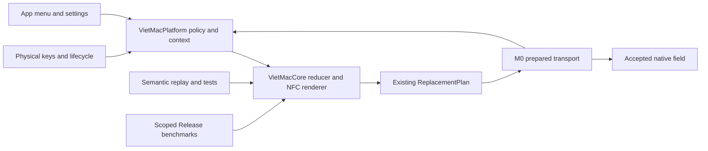

# Telex input MVP design

## Context

Verified at review commit `c714a6b69d772ff86ac137843ab6f5c43b9bfa15`: the package contains semantic contracts, a bounded suffix planner, permission preflight checks, and a menu shell.
There is no Telex reducer or native event transport.
The architecture review passed existing checks and 28,052 additional planner fixtures; those results establish neither language rules nor native compatibility.
See [proposal.md](proposal.md) for the outcome and exclusions.

Son selected `hòa`, `khỏe`, and `thúy` on 2026-10-13.
Other detailed escape and editing scenarios are proposed product behavior, not claims about a running implementation.
Son accepted FG-2, FG-3, and FG-4 on 2026-11-12. M1 core work may start before the `macos-transport-spike` gate closes; M2 integration may not.
The target architecture is in [architecture-spec.md](../../../docs/architecture-spec.md); decisions AD-10 to AD-18 below are taken from it.

## Goals / Non-Goals

**Goals:** one reusable semantic reducer, one renderer for every output path, state that matches the owned visible suffix, and separate evidence for language, adapter, native fields, and performance.

**Non-Goals:** a second transport system, a legacy packed-state port, raw-history restoration, language prediction, synchronous document reads on every key, or extra services/packages.
The proposal lists excluded product features.

## Decisions

### 1. Keep one package and the existing dependency direction

`VietMacCore` owns language values and transitions only.
`VietMacPlatform` owns normalization, context generation, event pairing, support policy, prepared transport, and lifecycle on one run loop.
`Apps/VietMac` presents settings and status; configuration reaches the owning loop as an immutable snapshot.
The return edge is the generated-event marker bypass, not another reducer pass.

Extend these existing targets rather than creating a package per component.
A small platform test target is justified for synthetic transport/context traces without permission-dependent key interception.
Replay and benchmarks remain development executables with no dependency entering the app.

### 2. Use typed visible-letter state instead of replaying raw keys

The reducer stores bounded logical letters with base, case, and shape; one optional word-level tone; context generation; and tracking/literal-until-boundary status.
A shape operation can retain a small semantic escape marker so its repetition restores the affected shape while preserving the tone.
The marker is invalidated with the word and is not an unbounded raw-key history.

Backspace removes a visible letter and recomputes the tone target.
It never pops a trailing tone key from a raw stack or imports a previous committed word.
This avoids divergence between visible text and a modifier history after editing.
Re-composition across boundaries would require a different ownership/history contract and remains excluded.

Validate `.asciiLetter(UInt8)` before applying letter rules.
The platform derives case from actual event text, not `Shift OR Caps Lock`; keycodes remain responsible for shortcuts/navigation only.
Unexpected semantic values invalidate state rather than entering an unchecked table index.

The reducer returns next state and an explicit intent containing complete previous/desired text and context.
Pass-through letters can update the predicted suffix; transformed or escaped keys are already included in desired text.
The adapter never appends an implicit restore key.
This keeps language behavior identical across transport profiles.

### 3. Make tone placement a case-independent semantic rule

Match rules on normalized base letters while preserving case for rendering.
Use explicit vowel-pattern data and the following precedence for supported nuclei:

1. Exclude `u` from an initial `qu` only when another vowel follows; exclude `i` from initial `gi` only when another vowel follows.
2. Prefer `ê` or `ơ` when present; for `ươ`, the tone belongs on `ơ`. Other single shaped-vowel nuclei retain that shaped target.
3. A one-vowel nucleus targets that vowel. Supported three-vowel nuclei target the middle vowel unless the shaped-vowel rule decides it.
4. Open unshaped `oa`, `oe`, and `uy` target their first vowel under Son's selected convention; a following valid final consonant moves the target to the second vowel.
5. Other supported two-vowel patterns use their explicit table entry, including final-glide patterns such as `ai`, `ao`, `au`, and `ay`.

Populate these patterns and their intermediate unshaped forms together so a late shape key and a tone entered before the final consonant remain deterministic.
The fixture families are `qu`, `gi`, `iê`, `yê`, `uô`, `ươ`, `oa`, `oe`, `uy`, and supported two/three-vowel forms.
The `thuowr` → `thuở` exception matches normalized letters/context and must produce the same rule result in uppercase and mixed case.
Do not inherit an entire OpenKey vowel table as a correctness oracle.

A supported modifier replaces the relevant shape/tone; repeating that accepted modifier restores it and appends the actual repeated character.
Escape enters literal-until-boundary state, preserving the remaining tone when a shape is removed.
Leading `w` also enters literal-until-boundary state; brackets are literal boundaries.
An ineligible `w`/`z` cannot disappear from the predicted word and later cause a tone to delete the wrong visible character.

One NFC renderer handles normal shapes, tone changes, escapes, and Backspace.
Directly writing a base character in a special restore branch is rejected because it can discard tone or case.
Structural eligibility does not prove that a word is Vietnamese; explicit English mode resolves that product ambiguity.

### 4. Reuse M0 preparation and commit state conservatively

Reduction computes a candidate transition without making it the accepted adapter state.
The adapter computes the existing replacement plan, prepares every event, rechecks context/support/capabilities, and posts in order on its owning run loop.
Only a successfully handled transition advances predicted composition; preparation failure clears state and preserves the physical key.
The original transformed key and its matching key-up follow the M0 consume policy.

Posting is not document acknowledgement.
A detected partial send, external edit, or uncertain focus invalidates state and pauses transformation without guessed rollback.
Profiles can differ in transport only after a native reproduction justifies them; they cannot redefine Telex.
Field identity and selected suggestions must be established in each accepted profile.
No cached PID or context token is treated as proof of document text.

Clear all state on observed navigation, selection, click/drag, edit shortcuts, app/field changes, input-source changes, mode changes, sleep/wake, and tap loss.
After a reset, the next letter starts a new word (Son, 2026-11-15). Replacements still delete only letters typed since the reset, in a settled field.
Do not adopt preceding document text.
Overflow always stays literal until a boundary, even if later Backspace shortens the visible word.
Keep the logical limit at 64 and encoded generated text within the planner's allowance.

### 5. Keep controls explicit and support policy conservative

Store desired Vietnamese/English mode separately from current availability.
Active transformation requires the accepted app/field profile, ABC or U.S. input, current capabilities, and no secure/uncertain context.
The app shows a concrete pause reason when any gate fails.
User exclusions override the tested scope; no per-app language memory is introduced.

Use the menu toggle immediately; the optional shortcut is initially unset and requires a non-modifier key plus Command, Control, or Option.
Ignore shortcut autorepeat until the corresponding physical release.
Do not reserve a guessed default or interpret modifier-release gestures.
A native test can configure a chord and record it after checking the required apps for conflicts.

Preferences use VietMac's own domain and are written outside the callback.
First launch is English mode; subsequent launches restore desired preferences without restoring composition.
Use macOS's main-app login registration for the opt-in setting, and present actual registration state.
Prevent a second transforming instance in the same user session; do not coordinate composition through shared process state.
Personal build/signing location remains stable for permission evidence.
The agent must not grant permissions, accept licenses, change global developer settings, install, or register startup automatically.

### 6. Verify language and native behavior with different evidence

Extend `vietmac-replay` with semantic-event fixtures while preserving its existing planner fixtures.
Each semantic fixture includes mode/configuration, context events, expected action, and exact text after every key.
Use explicit expected strings; randomized checks use a separate simulated document to verify ownership, pass-through, and NFC/bounds invariants.
They cannot establish linguistic correctness by agreeing with the production renderer.

Translate relevant OpenKey failure families to the selected MVP behavior: standalone `w`/brackets, case-independent `thuở`, preserved tone during shape escape, and no raw-history recovery after boundary deletion.
VNI/Windows failures do not become VietMac requirements.
Sanitizers run separately when indexes, bounds, or ownership change.

Create native evidence during implementation, with 17 field groups and the scenarios in `telex-mvp-acceptance`.
Each group tests a pre-populated synthetic prefix/suffix, `tieengs Vieetj`, edits, case, escapes, suggestion selection, focus transitions, and lifecycle where applicable.
Record exact text and caret/selection alongside formatting, clipboard, underline, and invisible-character checks.
Undo grouping can vary; require a correct controlled undo/redo round trip and report its actual steps.
Terminal transformation stays unsupported and must pass ordinary-input preservation tests.

Do not reduce the matrix when an app is unavailable.
Do not count M0's two rules as full-engine evidence.
Existing specifications under `openspec/specs` remain the delivered baseline until implementation and acceptance support promotion.

### 7. Extend benchmark scope without changing existing claims

Keep `make bench` as the existing planner benchmark.
Add an explicit reducer scope to the current benchmark executable and document a `make bench-engine` entry point during implementation.
The reducer scope includes transition plus rendering, with at least 1,000 warmup events and 10,000 measured synthetic events; it excludes planning and transport.

Reuse M0's bounded timing storage for callback own-work and export outside the callback.
Callback scope includes policy, normalization, reduction, planner, event preparation, and synchronous posting; it excludes client display acknowledgement.
The proposed MVP gates are reducer p99 < 1 ms and callback own-work p99 < 2 ms on the acceptance machine.
Measure Release without sanitizers/profilers and save workload, compiler, environment, sample count, percentiles, and maximum.
Keep native visible-latency method/resolution and allocation evidence distinct; do not infer them from a fast planner.

### 8. Field profiles replace the trial app set (AD-10, AD-11)

`FieldProfile` holds an ID, bundle ID, field kind, assurance, transport, a compile-time `accepted` flag, and the evidence artifact that justifies it (architecture-spec section 6.4).
Seventeen matrix groups map to ten profiles: `vscode.editor`, `vscode.find`, `vscode.quickInput`, three `*.addressBar`, three `*.webText`, and `notes.text`.
The resolver runs once per focused-element change, outside the callback, with a bounded ancestor walk. It reads role, subrole, identifier, control description, and ancestor roles only; never a value, selected text, title, or URL.
No match, an unaccepted profile, or an exclusion gives no transformation. A launch argument may enable unaccepted profiles for native test sessions and reports `testSession` in diagnostics.
`observed` is the only assurance level built. `eventOnly` is built only if Son selects it under FG-1.
Address bars stay `observed`; words stay literal while an inline completion is shown; no `selectionAware` transport in v0.1.
Benefit: fields graduate one at a time, which the dogfood build needs. Trade-off: every profile needs an identifying attribute beyond role, and some depend on UI language (**inferred**).

### 9. One status value, published by a run-loop observer (AD-12, AD-13, AD-15)

The platform exposes `RuntimeStatus` and five calls (`start`, `setMode`, `apply`, `resume`, `diagnostics`) as in architecture-spec section 7.2. The `ux-shell` change adds the value types; this change produces them and removes `M0StatusAdapter`.
Availability classes: Active, Standby (clears by itself), Blocked (Son must act; four sticky reasons need `resume`). Gate order: mode, capabilities, sticky pause, secure input, input source, conflicting tool, exclusion, field profile, field readability. The status reports the first failing gate.
Word-level literal holds (selection, lagging observation, escape, overflow) are counters, not status. M0's `uncertainContext` pause for a selection is dropped; the invalidation stays.
The platform owns the live mode because the shortcut changes it in the callback; the shell persists it. `Configuration` holds only the shortcut and exclusions.
Any mutation sets one dirty flag. One `CFRunLoopObserver` builds the status before the loop waits and publishes at most once per pass when it differs. The callback never publishes.
A unit test enumerates gate combinations and asserts that `availability == .active` equals the callback gate.

### 10. Tap lifetime, shortcut, and English mode (AD-14, AD-17)

The shortcut is matched inside the tap, so the tap stays installed in English mode only while a shortcut is configured; every other key passes through. `shortcutArmed` is the cached gate the callback checks before matching.
English mode performs no AX observation. The refresh still reads capabilities, secure input, frontmost app, input source, and the conflicting-tool check in every mode.
A capability loss removes the tap at once. On `com.apple.accessibility.api` the host removes the tap first and recreates it only after every read is true. Each refresh reads `CGEvent.tapIsEnabled`.
Trade-off: a trust change in any app costs one refresh interval of literal typing. That is the safe direction while U-3 is open.

### 11. Single instance and login startup (AD-16)

`InstanceLock` takes a non-blocking `flock` on `~/Library/Application Support/VietMac/instance.lock` before `InputHost` exists. A second process posts `local.sonquach.vietmac.reopen` and exits; the first instance opens Settings.
Login startup uses `SMAppService.mainApp`. The system status is the truth; the stored preference is only the last request.
Trade-off: registration after a rebuild in place or with ad hoc signing is **unknown** (U-7); M3 fixes a stable bundle location first.

### 12. Word start after a reset (AD-18)

Son decided on 2026-11-15: in Vietnamese mode, always type Vietnamese. After a reset the next letter starts a new word; no boundary key and no text read are needed. Overflow and the tone-move Backspace still hold until a boundary.
Letters typed while the only pause is `uncertainContext` are kept in memory (at most 64 ASCII letters) and adopted as the word only when the first reading shows a collapsed caret at the end of a field whose length equals their count. A profile is accepted only after U-14 passes in it.

### 13. Dogfood build (FG-4)

After M2, a build may enable only profiles whose full-engine rows passed, by native automation and a physical spot check, for every group the profile covers. M0 two-rule rows do not qualify. The build needs a recorded safe U-3 result and ships the `ux-shell` UI, not the M0 developer menu.
Other profiles show Standby `unsupportedField` or `unsupportedApp`. Son keeps a content-free log and exports a diagnostic report weekly.

## Risks / Trade-offs

- Unobserved document changes can invalidate the predicted suffix → use tested profiles, conservative resets, targeted native reproductions, and an unresolved-field completion block.
- Conservative literal fallback can reduce transformation availability → show the reason and resume only at a safe boundary/context; preserve text rather than guessing ownership.
- Telex also matches English identifiers → expose explicit mode controls; no automatic language claim.
- Vowel tables can encode a case-dependent exception → typed normalized rules and lower/upper/mixed-case fixture families.
- Escape and Backspace can diverge from raw input history → own visible logical state and keep committed-word restoration excluded.
- Event-based edits can create different undo grouping → record the grouping and require round-trip preservation, without a single-step promise.
- Local Release measurements do not establish all hardware/OS support → state the tested environment and retain older macOS/Intel as unverified unless tested.

## Migration Plan

1. Land M1 in parallel with the M0 native gate (FG-2). Run U-4 and U-5 natively early, because they can change the Core contract.
2. Complete and review M0 native evidence before beginning M2 integration.
3. Land M1 reducer, semantic replay, fixtures, and scoped benchmark with focused model/sanitizer checks and usage documentation.
4. Land M2 integration, tested-context gating, controls, and synthetic adapter checks; remove prototype language rules.
5. Ship the dogfood build with accepted profiles only, after U-3 is safe (FG-4).
6. Complete M3 stable personal build, native field matrix, lifecycle/startup tests, and performance evidence before claiming MVP completion.

These stages are outcomes inside one change, not a mandatory PR per component.
Review or merge in that order when separate PRs are useful; merging requires Son's authorization.
Until acceptance passes, retain the scaffold/native development status in user-facing documentation.
Disable transformation for rollback; do not repair user documents or replace installed input apps automatically.
Archive/sync only after completion criteria pass through the corresponding workflow.

## References

- [Official UniKey Telex manual](https://www.unikey.org/support/ukmanual.html): reference for modifier keys, tone replacement/removal, and repeated-key escape; not an oracle for every VietMac rule.
- [Official UniKey Simple Telex release](https://www.unikey.org/version_4_6_2.html): reference for preserving leading `w` and literal brackets.
- [VietMac provenance](../../../docs/provenance.md): exact OpenKey research commit and selected earlier regression evidence. No legacy source/table is copied by this planning change.
